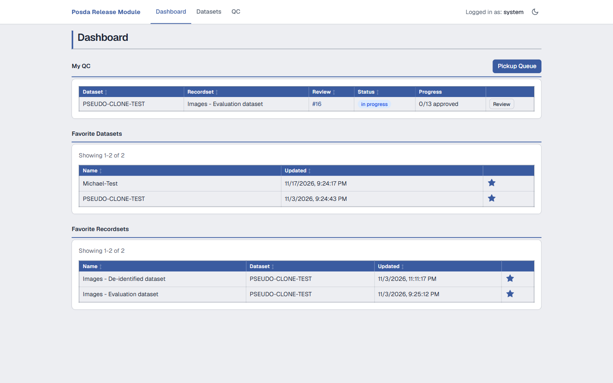
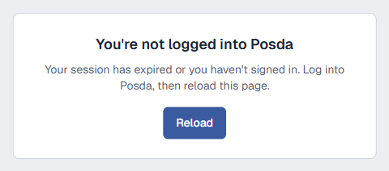
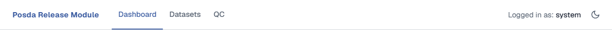
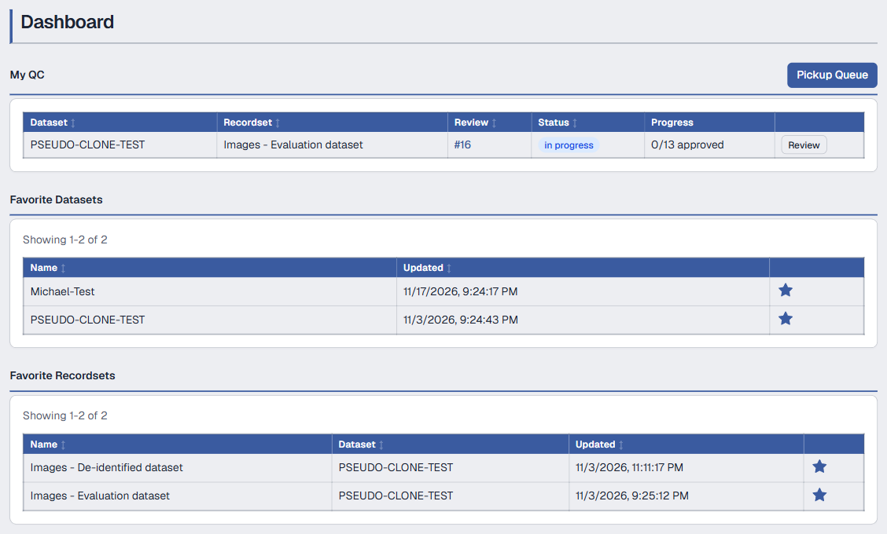
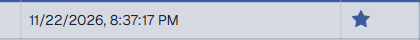

# Getting started

Signing in, finding your way around, and using your dashboard.

**Where:** `/release/` on your Posda server

## Before you start

- You need a Posda account. The Release Module uses your Posda login; it has
  no separate sign-in.
<!-- Q1: list the production and training server addresses here -->

## Signing in

1. Log into Posda as you normally do.
2. In the same browser, open `https://<posda-server>/release/`.

The module opens on your dashboard.

<!--  -->

## If you see "You're not logged into Posda" or "Can't reach Posda"

Both messages usually mean your Posda session has expired.

<!--  -->

1. Log into Posda again in another tab.
2. Come back and click **Reload**.

If **Can't reach Posda** keeps appearing after you log in, contact your Posda
administrator.

## The navbar

The bar across the top of every page.

<!--  -->

| Item | What it does |
|---|---|
| **Posda Release Module** | Returns to your dashboard |
| **Dashboard** | Your favorites and your QC work (below) |
| **Datasets** | The dataset list. Recordsets, releases and transfers are all reached from a dataset |
| **QC** | The QC pickup queue; see [QC queue & reviews](11-qc.md) |
| **Logged in as:** | The Posda user you're signed in as (wide screens only) |
| Sun / moon icon | Switches between light and dark theme. Your choice is remembered in this browser |

The section you're in is underlined.

## Your dashboard

The dashboard has three parts.

<!--  -->

### My QC Queue

QC reviews assigned to you that aren't complete yet, up to eight. Each line
shows the recordset, the review type and number, its status, and how many
series have been approved so far.

- Click a review to open it.
- Click **Pickup Queue** to find unassigned QC work. See
  [QC queue & reviews](11-qc.md).

If nothing is assigned to you, it says *Nothing assigned to you*.

### Favorite Datasets and Favorite Recordsets

Datasets and recordsets you've starred, most recently updated first. The
recordset table also shows which dataset each one belongs to.

- Click a row to open that dataset or recordset.
- Click the filled star to remove it from your favorites.

## Adding a favorite

Favorites are a shortcut to the datasets and recordsets you work on most.

1. Open the **Datasets** list, or the page for a dataset or recordset.
2. Click the star next to its name. A filled star means it's a favorite.

<!--  -->

It now appears on your dashboard. Favorites belong to you; other users don't
see them.

## Related

- [Concepts](01-concepts.md) — what datasets, recordsets and releases are
- [Back to contents](README.md)
