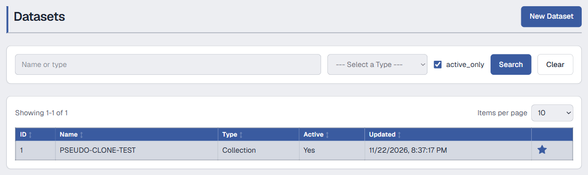
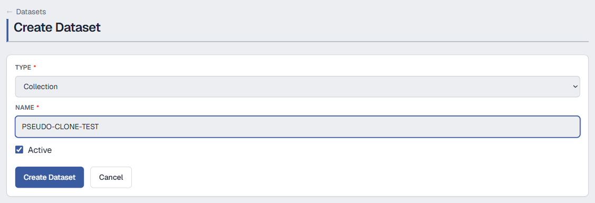
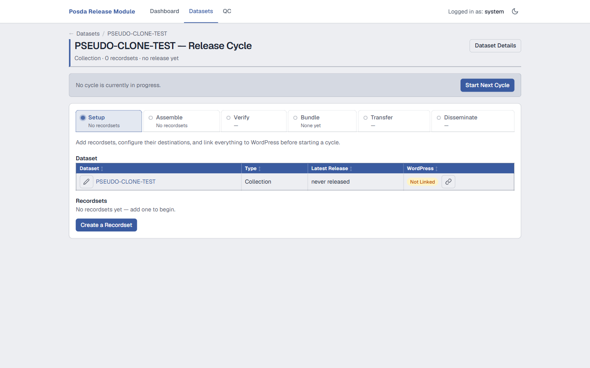
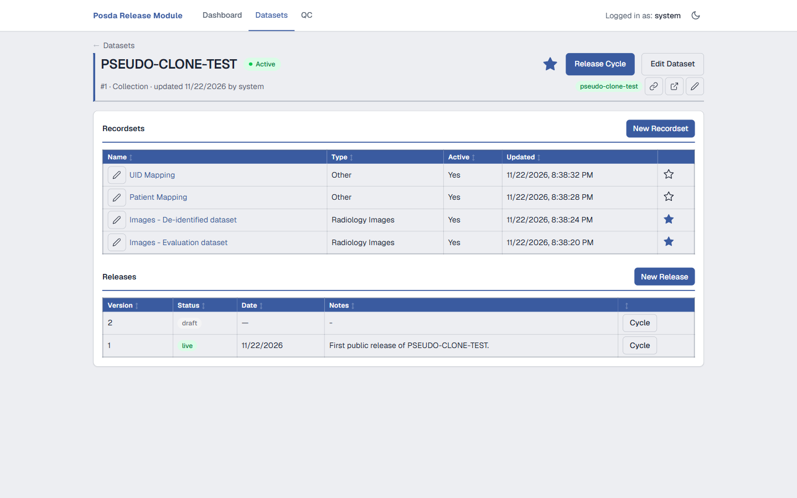

# Datasets

Finding, creating, and working with datasets.

**Where:** `/release/datasets` (**Datasets** in the navbar)

## Finding a dataset

1. Click **Datasets** in the navbar.
2. Type in **Search** to filter by name or type, or pick a **Type**.
3. Tick **active_only** to hide inactive datasets.
4. Click a row. The dataset opens on its [release cycle](04-cycle-overview.md),
   where most of the work happens.

Click **Clear** to reset the filters. The star at the end of each row adds the
dataset to your favorites.

## Creating a dataset

1. On the Datasets list, click **New Dataset**.
2. Fill in:

   | Field | Notes |
   |---|---|
   | **Name** | Required |
   | **Type** | Required. **Analysis Result** datasets link to an analysis-result page in WordPress; every other type links to a collection page |
   | **Active** | Inactive datasets are hidden when lists are filtered to active only |

3. Click **Create Dataset**.

The new dataset opens on its release cycle. Next, add recordsets and link the
dataset to WordPress, both in the cycle's [Setup stage](05-cycle-setup.md).

## The dataset details page

**Where:** **Dataset Details** in the cycle header
(`/release/datasets/:dataset_id/details`)

The header shows the dataset's name, an **Active**/**Inactive** badge, and:

| Control | What it does |
|---|---|
| Star | Add or remove from your favorites |
| **Release Cycle** | Back to the cycle view for the latest release |
| **Edit Dataset** | Change name, type, or Active |
| WordPress pill | Shows whether the dataset is linked to its WordPress page; click to link, change, or unlink |

Below the header:

- **Recordsets** — every recordset in the dataset. Click a row to open it, the
  pencil to edit it in place, or **New Recordset** to add one.
- **Releases** — every dataset release with its version, status, date and
  notes. Click a row to open the release; click **Cycle** to open that
  release's cycle view (useful for an older release still being shipped).

## Editing a dataset

1. In the cycle's Setup stage, click the pencil next to the dataset name. (Or
   **Edit Dataset** on the details page.)
2. Change the fields and save.

## Linking a dataset to WordPress

See [Linking WordPress pages](05-cycle-setup.md#linking-the-dataset-to-its-wordpress-page)
in the Setup chapter. The same dialog opens from the WordPress pill on the
details page.

## Related

- [Recordsets](03-recordsets.md)
- [The release cycle](04-cycle-overview.md)
- [Back to contents](README.md)
