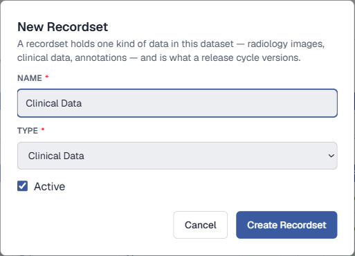
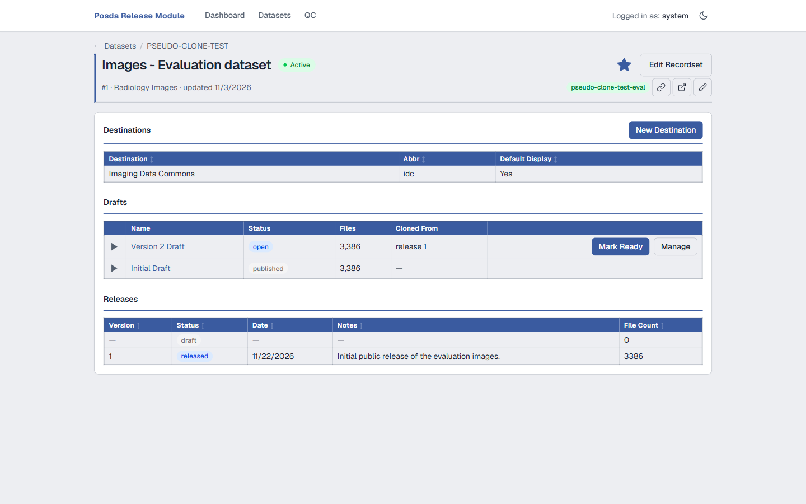
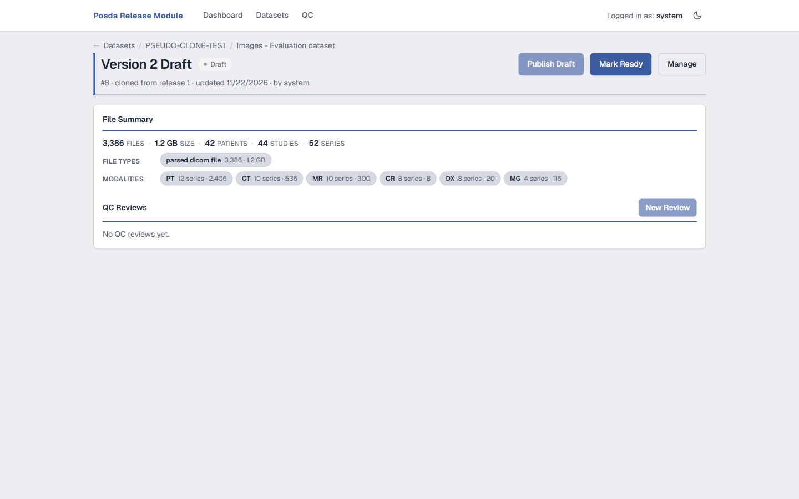

# Recordsets

Recordsets, their destinations, drafts, and releases, outside the cycle view.

**Where:** **Dataset Details** → **Recordsets** → click a recordset
(`/release/recordsets/:recordset_id`)

> **Tip:** During a release you'll do most of this from the cycle stages:
> destinations and WordPress links in [Setup](05-cycle-setup.md), drafts in
> [Assemble](06-cycle-assemble.md). The recordset page is useful for looking
> at one recordset's whole history.

## Creating a recordset

1. In the cycle's Setup stage, click **Create a Recordset**. (Or **New
   Recordset** on the dataset details page.)
2. Fill in:

   | Field | Notes |
   |---|---|
   | **Name** | Required |
   | **Type** | Required. What kind of data it holds |
   | **Active** | |

3. Click **Create Recordset**.

A new recordset has no destinations, no WordPress download page, and no
releases. Set up the first two in [Setup](05-cycle-setup.md); its first release
comes from a draft in [Assemble](06-cycle-assemble.md).

## The recordset page

The breadcrumb shows the dataset it belongs to. The header has the
**Active**/**Inactive** badge, a favorite star, **Edit Recordset**, and the
**Download** pill: whether the recordset is linked to its WordPress download
page.

### Destinations

Where this recordset's data is sent. **Default Display** marks the destination
its public download page points at.

- Click **New Destination** to add one.
- Click a row to edit it.

The first destination you add is always the default.

### Drafts

Every draft this recordset has had: open, ready, published and discarded.

- **New Draft** appears only when there's no open draft.
- Expand a row to see the draft's file summary.
- For an open draft, **Mark Ready** / **Reopen** and **Manage** work the same as
  in [Assemble](06-cycle-assemble.md).

Click a draft's name to open the draft page.

### Releases

Every published version: **Version**, **Status**, **Date**, **Notes** and
**File Count**. Click a row to open it.

## The draft page

`/release/recordsets/drafts/:draft_id`

Shows the draft's notes and **File Summary** (patients, studies, series, file
types, modalities). The header has:

| Button | What it does |
|---|---|
| **Mark Ready** / **Reopen** | Settle the file list for QC, or reopen it to change it. **Mark Ready** needs at least one file |
| **Manage** | Add or remove files, rename, edit notes, or discard. See [Assemble](06-cycle-assemble.md#managing-a-drafts-files) |
| **Publish Draft** | Freeze the draft into a new release. Disabled until QC passes: at least one complete review and none open or stale. Hover for the reason |

## The recordset release page

`/release/recordsets/releases/:release_id`

A read-only view of one published version: its number, date, notes, and
**File Summary**.

## Related

- [Assemble](06-cycle-assemble.md) — creating and filling drafts
- [Verify](07-cycle-verify.md) — the QC that gates publishing
- [Back to contents](README.md)
