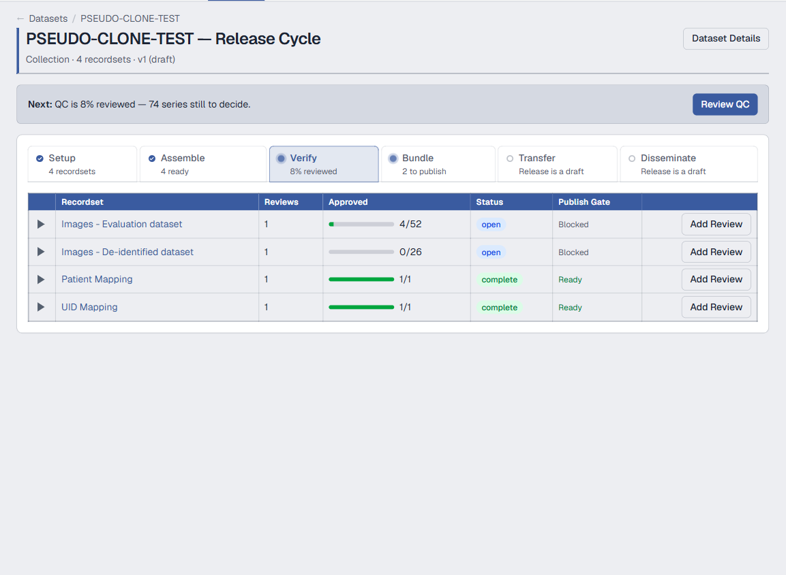
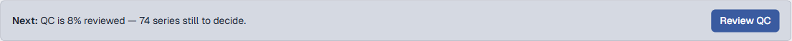
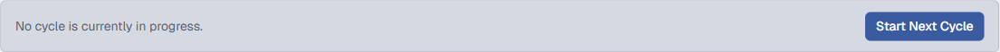
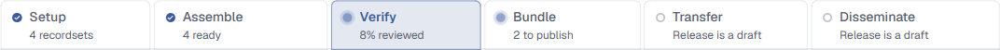

# The release cycle

Each dataset release goes through a cycle of six stages. The cycle view walks
you through them, and each stage has its own tab.

**Where:** click a dataset anywhere
(`/release/datasets/:dataset_id/releases/:release_id/cycle/<stage>`)

<!--  -->

| Stage | You do this | Which produces |
|---|---|---|
| [Setup](05-cycle-setup.md) | Add recordsets, set destinations, link WordPress pages | A dataset ready to release |
| [Assemble](06-cycle-assemble.md) | Create a draft for each recordset that's changing | Recordset drafts, marked ready |
| [Verify](07-cycle-verify.md) | QC each draft | Complete QC reviews |
| [Bundle](08-cycle-bundle.md) | Publish drafts and finalize the release | Recordset releases + a released dataset release |
| [Transfer](09-cycle-transfer.md) | Send the release to each destination | Delivered transfers |
| [Disseminate](10-cycle-disseminate.md) | Update download pages and go live | A live release |

## Opening the cycle view

Click a dataset in the **Datasets** list or among your dashboard favorites.
A dataset always opens on the cycle view for its latest release, on the first
stage that isn't finished.

## The header

The title is *Dataset name — Release Cycle*. Under it you see the dataset type,
how many recordsets it has, and the release you're looking at, for example
`v3 (draft)`. **Dataset Details** (and the dataset name in the breadcrumb)
opens the [dataset details page](02-datasets.md#the-dataset-details-page),
with its full list of recordsets and releases.

## The next-action banner

The banner under the header says, in one sentence, what the cycle needs next,
and gives you a button to go there.

<!--  -->

- **Next:** — the earliest stage with work to do. The button opens it
  (**Open Setup**, **Assemble**, **Review QC**, **Bundle Release**,
  **Review Transfers**, **Publish Pages**).
- **Blocked:** (amber) — something is wrong and needs fixing first, such as a
  stale QC review or a failed transfer. Blocked problems are shown ahead of
  ordinary next steps.
- No button — you're waiting on something outside the module, such as IDC
  processing.

## Starting a cycle

A cycle starts when you create a new **draft** dataset release. You can't
assemble, verify or bundle without one.

1. Open the cycle view. When no cycle is running the banner reads *No cycle is
   currently in progress*, with the last release's version if there is one.
2. Click **Start Next Cycle**.

<!--  -->

This creates the next version number as a draft release. You don't enter notes
yet; you add them when you finalize in [Bundle](08-cycle-bundle.md).

> **Note:** A dataset can have only one draft release at a time. **Start Next
> Cycle** appears only when no cycle is in progress, or when the previous
> release is fully distributed.

## Stage tabs

Each tab shows the stage name, a short status, and a state:

| State | Meaning |
|---|---|
| done | Nothing left to do in this stage |
| active | Work available now |
| blocked | Something needs fixing |
| pending | Waiting on an earlier stage |

Some example statuses: *2 no destination*, *1/3 ready*, *45% reviewed*,
*1 stale*, *2 to publish*, *v3 finalize*, *1 in flight*, *Set to Ready*,
*Waiting on IDC*, *v3 live*.

<!--  -->

You can open any tab at any time. Stages don't lock each other; each stage's
own buttons are disabled when their step isn't possible yet, and hovering over
a disabled button says why.

## Viewing an older release

Each dataset release keeps its own cycle view, so a release that's still
shipping stays reachable after the next cycle starts.

1. Click **Dataset Details**, then find the release under **Releases**.
2. Click **Cycle** on its row.

An amber note says you're looking at an older release, with a **Go to the
current cycle** link.

> **Note:** On an older release, Bundle, Transfer and Disseminate show *that*
> release. Setup, Assemble and Verify always show the recordsets' current state,
> because drafts and QC belong to a recordset, not to a past release.

## Related

- [Concepts](01-concepts.md)
- [Back to contents](README.md)
