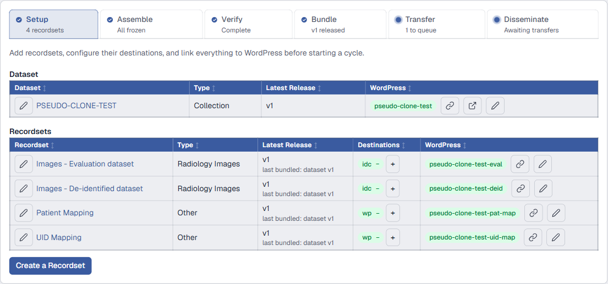
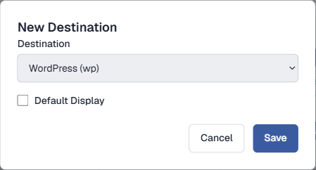
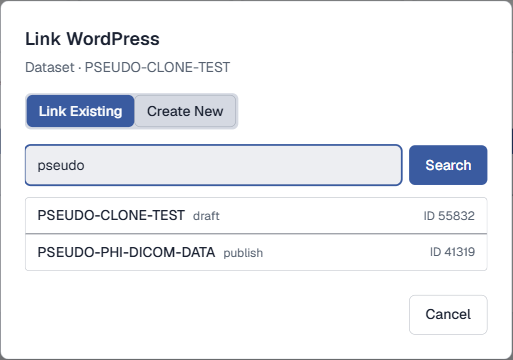

# Stage 1 — Setup

Get the dataset ready to release: its recordsets, where each one is sent, and
the WordPress pages they're published on.

**Where:** cycle view → **Setup** tab

<!--  -->

## When Setup is done

The Setup tab shows **done** when:

1. the dataset has at least one recordset,
2. the dataset is linked to its WordPress page,
3. every recordset has at least one destination,
4. every recordset is linked to a WordPress download page, and
5. the dataset's WordPress page has no **orphaned downloads** (see
   [below](#orphaned-downloads)).

Until then the tab names the first thing missing, for example
*Collection not linked* or *2 no destination*.

> **Note:** Setup doesn't block the rest of the cycle. You can start a cycle and
> assemble drafts before it's done. But Disseminate can't go live until every
> recordset in the release is linked to WordPress.

## The Setup page

There are two tables.

**Dataset**: one row with the dataset's name (the pencil edits it),
**Type**, **Latest Release**, and **WordPress** link status.

**Recordsets**: one row per recordset, with:

| Column | Shows |
|---|---|
| **Recordset** | Name (pencil edits it; the name opens the recordset in a new tab) |
| **Type** | |
| **Latest Release** | The latest published version, or *never released*, plus the dataset release it was last bundled into |
| **Destinations** | One pill per destination. Green = Default Display. **None** (amber) = no destinations yet |
| **WordPress** | Download-page link status |

## Adding a recordset

1. Click **Create a Recordset**.
2. Enter **Name** and **Type**.
3. Click **Create Recordset**.

The recordset is added to the table. See [Recordsets](03-recordsets.md) for
the fields.

## Setting a recordset's destinations

Each recordset needs at least one destination: where its data is sent when the
release is transferred.

1. In the recordset's **Destinations** cell, click **+**.
2. Pick a **Destination**.
3. Tick **Default Display** if this is the destination the public download page
   should point at.
4. Click **Save**.

<!--  -->

- The first destination you add is always the default.
- Click a destination pill to edit it, for example to change which one is the
  default.
- Click **−** on a pill to remove that destination.

<!-- Q: which destination each recordset type should normally use; see QUESTIONS.md Q6 -->

## Linking the dataset to its WordPress page

Do this before linking recordsets. A recordset's download page hangs off the
dataset's page.

1. In the **Dataset** table, click the link icon in the **WordPress** column.
2. In **Link WordPress**, either:
   - **Link Existing**: type part of the page title, then click the matching
     result; or
   - **Create New**: creates a new WordPress *draft* page and links it. The
     **Title** starts as the dataset name and the **Slug** follows it; change
     either before you create.

<!--  -->

The badge changes to show the page's status. Icons next to it open the page on
WordPress (view) or in the WordPress editor (edit).

Collection datasets link to a **Collection** page; **Analysis Result** datasets
link to an **Analysis Result** page.

## Linking a recordset to its download page

1. In the recordset's **WordPress** cell, click the link icon. It's disabled
   until the dataset itself is linked.
2. **Link Existing** lists *Unlinked downloads on this dataset's WordPress page*
   before you type anything. Pick the right one, or search by title.
   **Create New** makes a new draft download page instead. Its **Title**
   starts as the recordset name, and its **Slug** starts with the dataset's
   WordPress slug, for example `my-collection-ct-images`.

## Unlinking

Open **Link WordPress** again and choose **Unlink** → **Confirm Unlink**. This
only removes the connection in Posda; the WordPress page isn't deleted or
changed.

## Orphaned downloads

If the dataset's WordPress page lists downloads that no recordset here is linked
to, Setup shows an amber note: *N downloads listed on the dataset's WordPress
page aren't linked to any of these recordsets.*

This usually happens after a recordset was relinked, or a download was added
directly in WordPress. To clear it, link each orphan to the recordset it belongs
to (they appear as suggestions in **Link Existing**), or remove it from the page
in WordPress.

## Related

- [The release cycle](04-cycle-overview.md) — starting a cycle
- [Assemble](06-cycle-assemble.md)
- [Back to contents](README.md)
