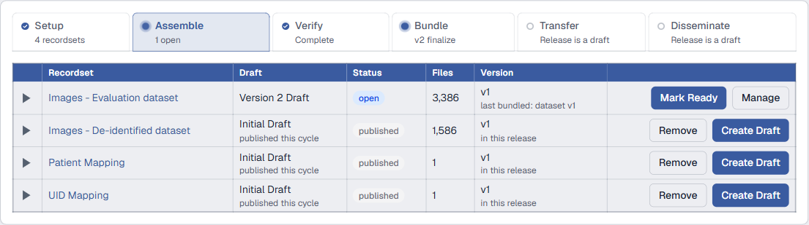
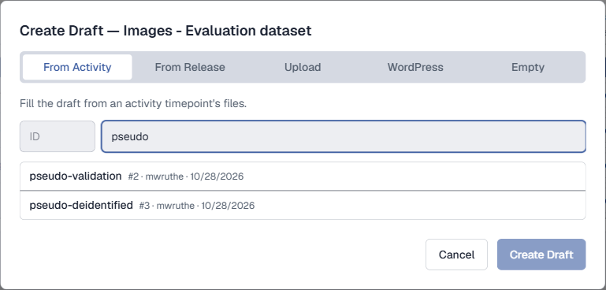
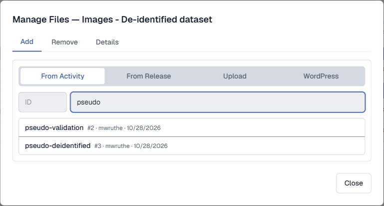

# Stage 2 — Assemble

Decide which recordsets change in this release, and build a draft of each one's
new contents.

**Where:** cycle view → **Assemble** tab

## Before you start

- A cycle must be in progress. If it isn't, Assemble is read-only and says to
  start one from the banner. See [Starting a cycle](04-cycle-overview.md#starting-a-cycle).
- Know which activity timepoint, or other source, holds each changed
  recordset's new files.

## The Assemble table

One row per recordset:

| Column | Shows |
|---|---|
| **Recordset** | Name |
| **Draft** | The open draft's name; or *carrying forward* (no change this release); *published this cycle*; or **Never released**, which means it won't be in this release without a draft |
| **Status** | The draft's status: open or ready |
| **Files** | File count |
| **Version** | Latest published version, and whether it's *in this release* |

Expand a row (**contents**) to see the draft's file summary: patients, studies,
series, file types and modalities.

## Recordsets that aren't changing

You don't need to do anything. Recordsets without a draft are **carried
forward**: the release includes their latest version unchanged.

To leave a recordset out of this release entirely, click **Remove** on its
row. **Add Back** reverses that.

## Creating a draft

1. On the recordset's row, click **Create Draft**.
2. Choose where its files come from:

   | Tab | Use it when |
   |---|---|
   | **From Activity** | The new files are in a Posda activity. Search for the activity, then pick a **Timepoint** (the latest is selected by default) |
   | **From Release** | Starting from a previous version, then changing it |
   | **Upload** | The files are on your computer |
   | **WordPress** | Pulling the file attached to the recordset's WordPress download (only shown if the recordset is linked) |
   | **Empty** | You'll add files afterward |

3. Click **Create Draft**.

The row now shows the draft, its status (open), and file count.

## Managing a draft's files

Click **Manage** on the row. The dialog has three tabs.

### Add

Bring more files in from an activity, a release, an upload, or WordPress, the
same sources as Create Draft. Each source offers two operations:

- **Merge** — add to what's there. For an activity, you choose whether to:
  - **Add *N* new series not in the draft**,
  - **Replace *N* changed series with the timepoint's files** (identical ones
    are skipped), and
  - **Add *N* non-DICOM files**. If a file has the same name as one already in
    the draft, you choose whether to replace it or skip it.

  Click **Apply Merge**. Series only in the draft are left alone.
- **Replace all** — throw away the draft's contents and use this source
  instead. Click **Replace Draft Contents**, then click again to confirm
  within a few seconds.

### Remove

Search the draft by **Patient**, **Study UID**, **Series UID**, **SOP UID** or
**File ID**, then remove whole series: click **Remove** on a match, then
**Confirm remove?** within a few seconds. Nothing is listed until you enter a
search.

### Details

Change the **Draft Name** and **Notes**, or **Discard Draft** (click again to
confirm).

## Marking a draft ready

When a draft's files are right, click **Mark Ready** on its row.

- **Mark Ready** is disabled until the draft has at least one file.
- A ready draft can't be changed: **Manage** is disabled. QC samples a ready
  draft, so its files must stay put.
- To change it, click **Reopen**. Any QC review already drawn from it will go
  **stale** if the files change. See [Verify](07-cycle-verify.md#stale-reviews).

Assemble is **done** when every open draft is marked ready.

## Related

- [Verify](07-cycle-verify.md) — next stage
- [Recordsets](03-recordsets.md) — the same draft actions outside the cycle
- [Back to contents](README.md)
