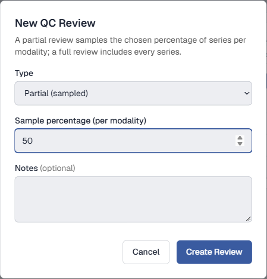
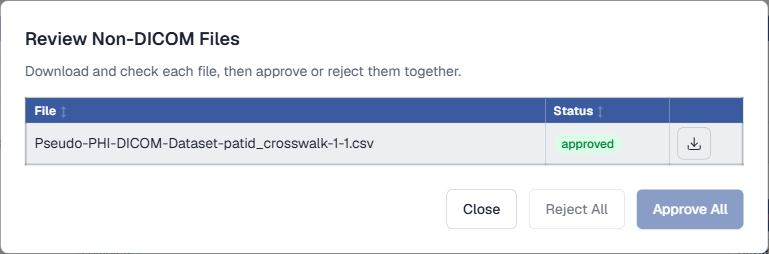

# Stage 3 — Verify

Quality-check each draft. A draft can't be published until it passes QC.

**Where:** cycle view → **Verify** tab

## Before you start

- The draft must be marked ready in [Assemble](06-cycle-assemble.md). QC samples
  the draft's files, so it can't start while they're still changing. **Start QC**
  is disabled until then.

## The Verify table

<!--  -->

One row per recordset being changed this cycle:

| Column | Shows |
|---|---|
| **Reviews** | How many QC reviews the draft has |
| **Approved** | A progress bar of approved / rejected / flagged series |
| **Status** | pending, open, complete, or stale |
| **Publish Gate** | **Ready** (can be published), **Blocked**, or **Frozen vN** (already published this cycle) |

Expand a row (**reviews**) to see each review and its slices, with a **Review**
button per slice and **Manage** per review.

## The publish gate

A draft can be published only when it has **at least one complete review** and
**no open or stale reviews**.

## Starting QC

1. On the recordset's row, click **Start QC**.
2. Choose the **Type**:
   - **Full (all series)** — every DICOM series is reviewed.
   - **Partial (sampled)** — enter a **Sample percentage (per modality)**,
     1–100.
3. Optionally add **Notes**.
4. Click **Create Review**.

<!--  -->

The first review on a draft is assigned to you. Later reviews (**Add Review**)
are created unassigned.

A draft with only non-DICOM files gets a **New Non-DICOM Review** instead.
There's no sampling; it covers every file.

<!-- Q: when to use full vs partial, and what percentage; see QUESTIONS.md Q8 -->

## Reviewing

### DICOM: in Mirabelle

1. Expand the row and click **Review** on your slice.
2. Mirabelle opens with that slice's series. Approve, reject or flag each one
   there.

<!-- Q: Mirabelle steps; see QUESTIONS.md Q9 -->

Progress comes back to the **Approved** bar as you work.

### Non-DICOM files

1. Click **Review** on your slice. **Review Non-DICOM Files** opens with the
   slice's files.
2. Download each file (download icon) and check it.
3. Click **Approve All**, or **Reject All** and give a reason.

<!--  -->

### When a review is complete

A review becomes **complete** automatically once every unit is approved. There's
no "complete" button. A completed review is locked.

A **rejected** series keeps the review open and the gate shut. Fix the draft in
Assemble (**Reopen**, change the files, **Mark Ready**), then re-review.

## Sharing the work: slices

A big review can be split so several people work on it at once.

1. Expand the row and click **Manage** on the review.
2. Under the slices, click **Split**.
3. Choose either:
   - **Into *N* unclaimed slices** — others pick them up from the
     [QC queue](11-qc.md); or
   - **Assign to reviewers** — tick the people, one slice each.
4. Confirm.

<!--  -->

Per slice, you can:

| Action | What it does |
|---|---|
| **Claim** | Take an unclaimed slice |
| **Release** | Give your slice back, unassigned |
| **Assign** | Give the slice to someone else |
| **Review** | Open it (Mirabelle, or the non-DICOM dialog) |

- Splitting into 1 slice merges them back together.
- Once any slice is complete, the review can't be re-split, because that would
  lose who did the work.
- A finished slice can't be released or reassigned.

## Stale reviews

If a draft's files change after a review was drawn, the review goes **stale**.
The Verify tab shows **blocked** and the banner says to re-clone. The review
shows how many series changed, need adding, or need dropping.

1. Expand the row, click **Manage** on the stale review.
2. Click **Clone**, and choose:
   - **Carry forward** — re-sample the current draft with the same seed and
     keep earlier decisions. Changed series go back to pending. This is usually
     what you want.
   - **Resample** — a fresh draw with no decisions carried over.
3. Confirm.

Non-DICOM reviews always carry forward.

## Cancelling a review

**Manage** → **Cancel Review**. Use this for a review created by mistake. A
complete review can't be cancelled. Cancelled reviews sink to the bottom of the
list.

## Related

- [QC queue & reviews](11-qc.md) — picking up QC work outside the cycle
- [Bundle](08-cycle-bundle.md) — next stage
- [Back to contents](README.md)
