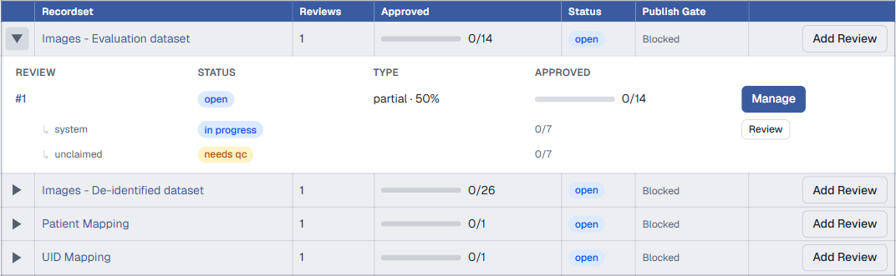
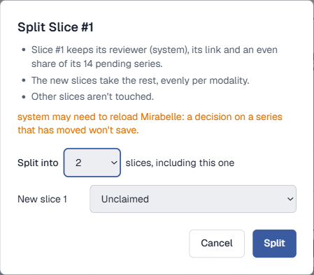
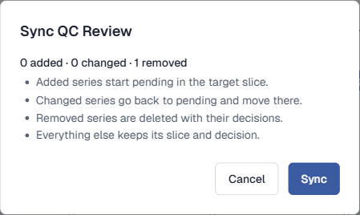

# Stage 3 — Verify

Quality-check each draft. A draft can't be published until it passes QC.

**Where:** cycle view → **Verify** tab

## Before you start

- The draft must be marked ready in [Assemble](06-cycle-assemble.md). QC samples
  the draft's files, so it can't start while they're still changing. **Start QC**
  is disabled until then.

## The Verify table

<!--  -->

One row per recordset being changed this cycle:

| Column | Shows |
|---|---|
| **Reviews** | How many QC reviews the draft has |
| **Approved** | A progress bar of approved / rejected / flagged series |
| **Status** | pending, open, complete, or stale |
| **Publish Gate** | **Ready** (can be published), **Blocked**, or **Frozen vN** (already published this cycle) |

Expand a row (**reviews**) to see each review and its slices, with a **Review**
button per slice and **Manage** per review.

## The publish gate

A draft can be published only when it has **at least one complete review** and
**no open or stale reviews**.

## Starting QC

1. On the recordset's row, click **Start QC**.
2. Choose the **Type**:
   - **Full (all series)** — every DICOM series is reviewed.
   - **Partial (sampled)** — enter a **Sample percentage (per modality)**,
     1–100.
3. Optionally add **Notes**.
4. Click **Create Review**.

<!--  -->

The review starts as one unclaimed slice, because release QC is normally done
by another team. A reviewer picks it up from the [QC queue](11-qc.md), or you
can **Claim** it or **Assign** it from the slice's row. Later reviews (**Add
Review**) start the same way.

A draft with only non-DICOM files gets a **New Non-DICOM Review** instead.
There's no sampling; it covers every file.

<!-- Q: when to use full vs partial, and what percentage; see QUESTIONS.md Q8 -->

## Reviewing

### DICOM: in Mirabelle

1. Expand the row and click **Review** on your slice.
2. Mirabelle opens with that slice's series, on the first one still to decide.
   Approve, reject or flag each one there.

<!-- Q: Mirabelle steps; see QUESTIONS.md Q9 -->

Progress comes back to the **Approved** bar as you work.

### Non-DICOM files

1. Click **Review** on your slice. **Review Non-DICOM Files** opens with the
   slice's files.
2. Download each file (download icon) and check it.
3. Click **Approve All**, or **Reject All** and give a reason.

<!--  -->

### When a review is complete

A review becomes **complete** automatically once every unit is approved. There's
no "complete" button. A completed review is locked.

A **rejected** series keeps the review open and the gate shut. Fix the draft in
Assemble (**Reopen**, change the files, **Mark Ready**), then re-review.

## Sharing the work: slices

A big review can be shared so several people work on it at once. You split
and combine one slice at a time; other slices aren't touched.

### Splitting a slice

1. Expand the row and click **Manage** on the review.
2. On the slice's row, click **Split**.
3. In **Split into**, choose how many slices you want, counting this one.
4. For each new slice, pick a reviewer, or leave it **Unclaimed** so others
   pick it up from the [QC queue](11-qc.md).
5. Click **Split**.

<!--  -->

The original slice keeps its reviewer, its review link, any series already
decided, and an even share of the pending series. The new slices share the
rest, evenly per modality.

**Split** is disabled when the slice has fewer than 2 pending series.

### Combining slices

Use this to hand a slice's remaining work to another slice, for example when a
reviewer drops out.

1. On the slice's row, click **Combine**.
2. Under **Combine into**, pick the slice to move its series to.
3. If the slice already has decided series, tick **Bring decided series too**
   to move those as well.
4. Click **Combine**.

If nothing is left in the original slice, it's deleted. Otherwise it keeps its
decided series and its reviewer, and is then complete. **Combine** is disabled
when there's no other unfinished slice.

> **Note:** If the slice belongs to someone, they may need to reload
> Mirabelle after a split or combine. A decision on a series that has moved
> won't save.

### Other slice actions

| Action | What it does |
|---|---|
| **Claim** | Take an unclaimed slice |
| **Release** | Give your slice back, unassigned |
| **Assign** | Give the slice to someone else |
| **Review** | Open it (Mirabelle, or the non-DICOM dialog) |

A finished slice can't be released, reassigned, split or combined.

## Stale reviews

If a draft's files change after a review was drawn, the review goes **stale**.
The Verify tab shows **blocked**, the banner says to sync, and the review row
says *open to sync*.

Syncing updates the same review in place:

- **Added** series start pending.
- **Changed** series go back to pending.
- **Removed** series are deleted, with their decisions.
- Everything else keeps its slice and its decision.

1. Expand the row, click **Manage** on the stale review.
2. Click **Sync**. The dialog shows how many series were added, changed and
   removed.
3. If there's new work (added or changed series), choose where to **Send the
   new work to**:
   - **A new slice**, unclaimed, with its own review link; or
   - an existing unfinished slice, listed with its reviewer and size.
4. Click **Sync**.

<!--  -->

The dialog warns you if a slice will be deleted because none of its series
remain in it. Non-DICOM reviews sync the same way, by file.

## Cancelling a review

**Manage** → **Cancel Review**. Use this for a review created by mistake. A
complete review can't be cancelled. Cancelled reviews sink to the bottom of the
list.

## Related

- [QC queue & reviews](11-qc.md) — picking up QC work outside the cycle
- [Bundle](08-cycle-bundle.md) — next stage
- [Back to contents](README.md)
