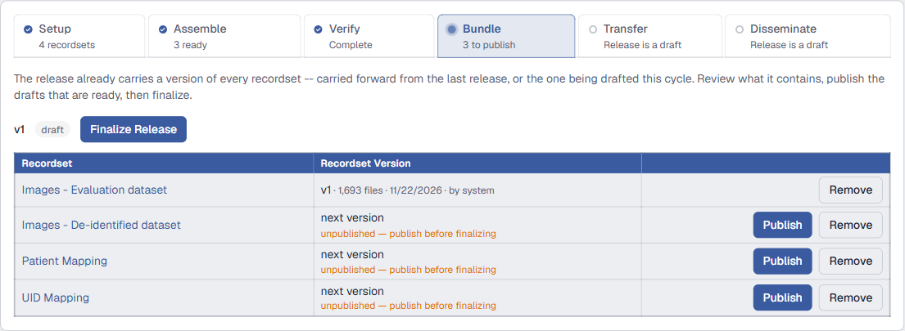
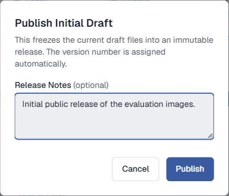
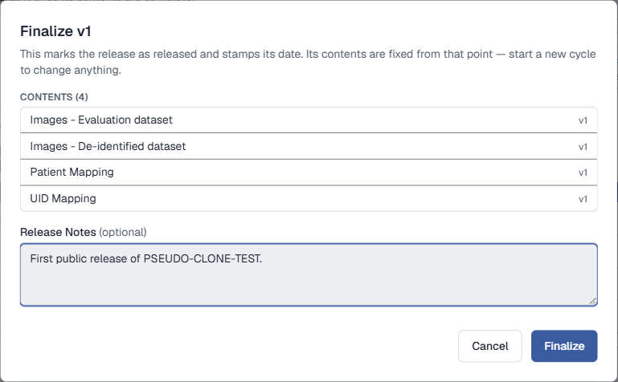

# Stage 4 — Bundle

Publish the drafts that passed QC, check what the release carries, and finalize
it.

**Where:** cycle view → **Bundle** tab

> The release already carries a version of every recordset: carried forward
> from the last release, or the one being drafted this cycle. Review what it
> contains, publish the drafts that are ready, then finalize.

## The Bundle page

<!--  -->

The top line shows the dataset release's version and status, with
**Finalize Release**.

The table has one row per recordset: **Recordset**, the **Recordset Version**
the release carries (with file count, date and author), and actions.

An amber warning lists recordsets that have a published version but aren't
in the release. Include them if they should ship.

## Publishing a draft

Publishing freezes a draft's files into a new, unchangeable recordset release.

1. On a recordset whose draft passed QC, click **Publish**.
2. Optionally add **Release Notes**.
3. Click **Publish**.

<!--  -->

The version number and date are assigned automatically. The row now shows the
new version.

**Publish** appears only when the draft has passed the
[publish gate](07-cycle-verify.md#the-publish-gate).

## Changing what the release carries

| Button | What it does |
|---|---|
| **Change version** | Pick a different published version of this recordset (newest first; the current one is marked) |
| **Include** | Put a left-out recordset back in: its open draft, or its latest version |
| **Remove** | Leave this recordset out of the release |

## Finalizing the release

Finalizing fixes the release's contents (draft → **released**). After this it
can't be changed. A correction means a new cycle.

1. Click **Finalize Release**.
2. Check the summary of every recordset version the release contains.
3. Optionally add **Release Notes**.
4. Click **Finalize**.

<!--  -->

Finalize is blocked when:

- the release contains no recordsets, or
- a recordset in it is still on an unpublished draft. Publish it, or remove it
  from the release, first.

It warns, but doesn't block, if a frozen recordset is left out.

After finalizing, the banner moves you on to [Transfer](09-cycle-transfer.md).

## Related

- [Verify](07-cycle-verify.md)
- [Transfer](09-cycle-transfer.md) — next stage
- [Back to contents](README.md)
