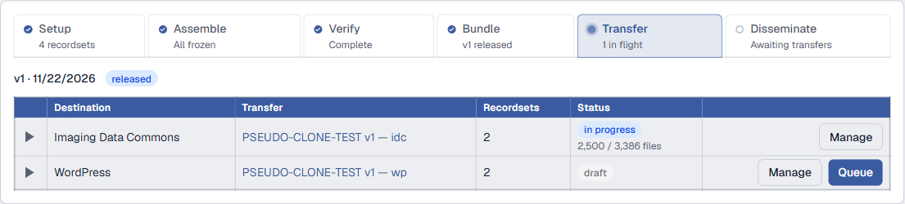
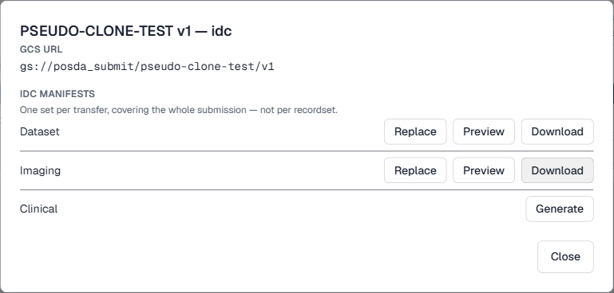
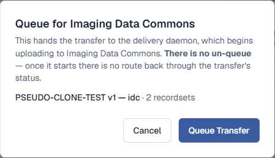

# Stage 5 — Transfer

Send the finalized release to each of its destinations.

**Where:** cycle view → **Transfer** tab

## Before you start

- The release must be finalized in [Bundle](08-cycle-bundle.md). Until then the
  tab reads *Release is a draft*.
- Each recordset in the release needs a destination, set in
  [Setup](05-cycle-setup.md#setting-a-recordsets-destinations).

## The Transfer table

One row per **destination** the release ships to: not per recordset. A transfer
carries every recordset in the release that's routed to that destination.

| Column | Shows |
|---|---|
| **Destination** | Destination name |
| **Transfer** | The transfer's name, once created |
| **Recordsets** | How many recordsets it carries |
| **Status** | Transfer status and file progress (*120 / 300 files*, *N failed*). For a delivered IDC transfer, IDC's own status instead |

Expand a row to see what the transfer carries. For IDC this is grouped by
manifest: **Imaging manifest**, **Clinical manifest**, and **Not manifested for
IDC**.

Warnings above the table:

- *N recordsets in this release have no destination configured* — they'll
  ship nowhere. Fix in Setup.
- *N transfers no longer match what this release bundles* — click **Sync** on
  those rows.

## Creating a transfer

On a destination row with no transfer yet, click **Create**. The transfer is
created as a **draft**. Nothing is sent yet.

If you change the release's contents afterward, the row shows **Sync**. Click
it to bring the transfer up to date.

## Configuring a transfer

Click **Manage** on the row.

| Destination | Settings |
|---|---|
| **IDC** | **GCS URL**, set automatically from the dataset's WordPress page. **IDC Manifests**: generate the dataset, imaging and clinical manifests |
| **Aspera** | **Faspex URL** |
| **NBIA** | **Collection** and **Site** |
| All | **Published** and **Public** flags |

Click **Save Settings** after changing fields.

### IDC manifests

IDC reads a submission from its manifests, so they must exist before you can
queue. There's one set per transfer, covering the whole submission, not one per
recordset.

1. In **Manage**, under **IDC Manifests**, click **Generate** for each type.
2. Use **Preview** or **Download** to check one. **Replace** regenerates it.

> **Note:** The **clinical** manifest needs the release's **WordPress** transfer
> to have run first. IDC links to the files that transfer uploaded. Queue
> WordPress before generating IDC's clinical manifest.

## Queueing a transfer

Queueing hands the transfer to the delivery service, which starts uploading.

1. Click **Queue** on the row.
2. Read the confirmation and fix any warnings it shows.
3. Click **Queue Transfer**.

> **Warning:** There is no un-queue. Once a transfer starts, its status can't be
> sent back.

**Queue Transfer** is disabled, with the reason shown on hover, when:

- the transfer no longer matches the release: **Sync** it first,
- an IDC manifest is missing: generate it first, or
- the transfer has no bucket path. This happens when the dataset has no
  WordPress page linked.

It also warns about files that are neither DICOM nor clinical data. No IDC
manifest can list them, so **they won't be sent**. If they belong at IDC, fix
the recordset's destinations.

### The WordPress transfer

This uploads each recordset's file to the WordPress media library. **The
download pages don't change yet**; you do that in
[Disseminate](10-cycle-disseminate.md). It's safe to run again; files already
uploaded are reused.

## Watching progress

The **Status** column updates as files upload: **queued**, **in progress**,
then **success** or **failed**. The tab shows *N in flight* meanwhile.

### Failed transfers

The tab shows **blocked** and the banner names the failed destinations. For IDC
and WordPress, click **Queue** again to retry. Only the files that failed are
retried.

<!-- Q: what to do when a retry also fails; see QUESTIONS.md Q12 -->

## IDC: after the upload

Once an IDC transfer reaches **success**, its status column shows IDC's own
status, read live from the bucket:

| IDC status | Meaning | What you do |
|---|---|---|
| **Draft** | Uploaded; IDC won't touch it yet | Click **Set to Ready** |
| **Ready for processing** / **Processing** | IDC has it | Wait. The banner has no button |
| **Processed** | IDC has published it | Nothing. Transfer is **done** |
| **Errored** | IDC found problems | Fix them and push again |

**Set to Ready** asks you to confirm: *IDC can pick this version up at any time
from now on.* Until IDC starts, **Queue** re-pushes the transfer. That checks
every file again, uploads only what changed, replaces the manifests, and puts
the version back to **Draft**, so set it to Ready again afterward. Once IDC has
started, a change needs a new release.

<!-- Q: how long IDC processing usually takes / who to contact on Errored; see QUESTIONS.md Q13 -->

## Related

- [Transfers](12-transfers.md) — the same transfers outside the cycle
- [Disseminate](10-cycle-disseminate.md) — next stage
- [Back to contents](README.md)
