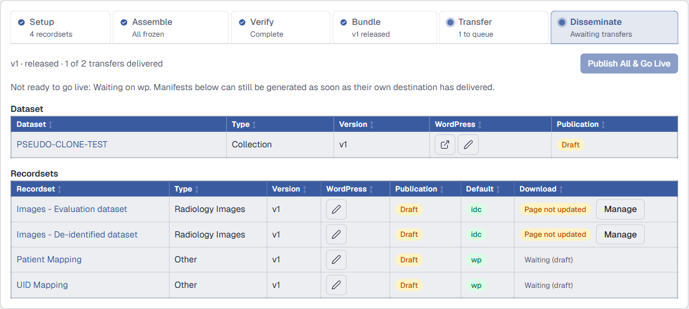
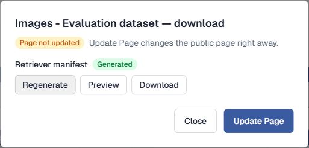

# Stage 6 — Disseminate

Put the right file on each recordset's WordPress download page, then publish
every page and mark the release **live**.

**Where:** cycle view → **Disseminate** tab

## Before you start

- The release must be finalized ([Bundle](08-cycle-bundle.md)).
- Transfers must have landed ([Transfer](09-cycle-transfer.md)). You can work on
  a recordset's row as soon as *its* destination is delivered. Going live waits
  for all of them.
- Every recordset in the release, and the dataset, must be linked to WordPress
  ([Setup](05-cycle-setup.md)).

## Why this is a separate step

Transfers only *stage* files. The public download pages keep pointing at the
previous files until you update them here. Nothing public changes until you
click **Update Page** or **Publish All & Go Live**.

## The Disseminate page

<!--  -->

**Dataset**: the dataset's WordPress page, its **Version**, and its
**Publication** status (draft or published in WordPress).

**Recordsets**: one row per recordset in the release:

| Column | Shows |
|---|---|
| **Version** | The version this release carries |
| **WordPress** | Download-page link; **Not Linked** if missing |
| **Publication** | Whether the WordPress page is published |
| **Default** | The recordset's Default Display destination: where its download points |
| **Download** | **Page updated** / **Page not updated**, *Waiting (…)* while its transfer runs, or **No transfer** |

## Updating a download page

1. Click **Manage** in the recordset's **Download** column.
2. What you see depends on the default destination:
   - **A retriever manifest** (IDC, NBIA, …): click **Generate** to build it.
     **Preview** and **Download** let you check it, and **Regenerate** rebuilds
     it.
   - **A WordPress data file**: it was already uploaded by the WordPress
     transfer. Nothing to generate.
3. Click **Update Page**.

<!--  -->

> **Warning:** **Update Page** changes the public page right away.

The row changes to **Page updated**. If the page already had that exact file,
you'll be told so. That's normal for a recordset whose series didn't change.

A manifest for a recordset with no DICOM series is generated empty, with a
message saying so.

## Going live

1. Update every recordset's download page (above).
2. Click **Publish All & Go Live**.

This publishes the dataset's page and every recordset's download page in
WordPress, then marks the release **live**.

The button is disabled, with the reason on hover, until:

- every transfer has been delivered,
- for IDC, IDC reports **Processed** (*Waiting on IDC to publish*), because the
  release goes live together with IDC,
- every download page is updated (*Update the download for …*), and
- the dataset and every recordset in the release are linked to WordPress.

If some pages fail to publish, you'll see which ones and why. The release stays
**released**, not live, so you can fix them and click again.

When it succeeds, the tab shows *vN live* and the banner offers
**Start Next Cycle**.

## Related

- [Transfer](09-cycle-transfer.md)
- [The release cycle](04-cycle-overview.md)
- [Back to contents](README.md)
