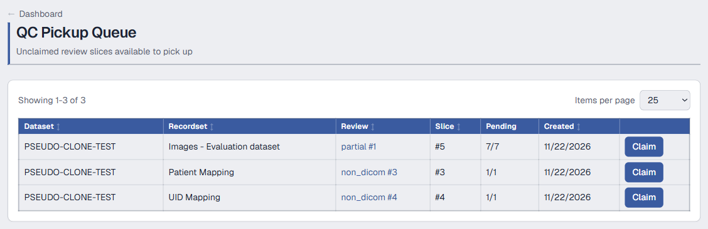
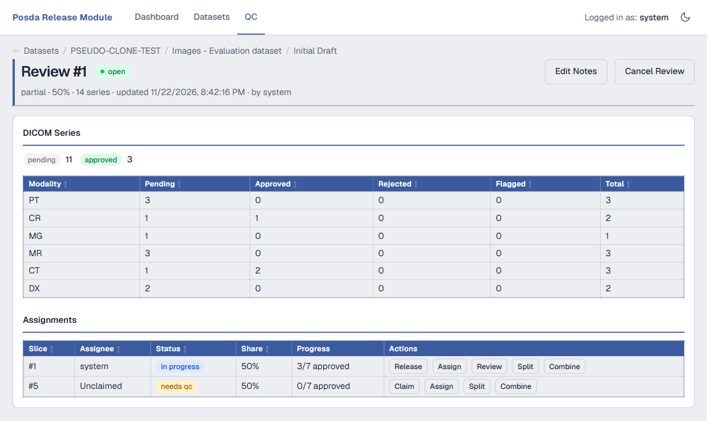

# QC queue & reviews

Find QC work and do it, without going through a dataset's cycle. This is
mostly for QC reviewers. Curators usually start QC from the cycle's
[Verify stage](07-cycle-verify.md).

**Where:** **QC** in the navbar (`/release/qc/queue`)

## Your assigned work

Your dashboard's **My QC Queue** lists slices assigned to you that aren't
complete, with progress (*12/40 approved*). Click one to open its review. See
[Getting started](00-getting-started.md#my-qc-queue).

## The pickup queue

**QC Pickup Queue** lists unclaimed slices anyone can take.

<!--  -->

| Column | Shows |
|---|---|
| **Dataset** / **Recordset** | What's being reviewed |
| **Review** | The review it belongs to |
| **Slice** | Which share of the review |
| **Pending** | Units still to decide |
| **Created** | When the review was created |

### Picking up a slice

1. Click **Pickup Queue** on your dashboard, or **QC** in the navbar.
2. Click **Claim** on a slice.

It leaves the queue and appears in your **My QC Queue**.

## The review page

`/release/qc/reviews/:review_id`

<!--  -->

The breadcrumb shows the dataset, recordset and draft under review. The page
shows:

- the review's status (open, complete, stale, cancelled) and type
  (full, partial, non-DICOM),
- **DICOM Series** (or **Files** for a non-DICOM review): counts by status and
  modality,
- the **slices** table: **Assignee** (*Unclaimed* if none), **Status**,
  **Share**, **Progress**, and actions,
- for a non-DICOM review, the file list, with each file's status and a download
  link. Hover over a rejected file to see who rejected it and why.

You can edit the review's **Notes** (**Edit Notes**), and the header has
**Clone** (stale reviews only) and **Cancel Review**.

### Doing the review

- **DICOM**: click **Review** on your slice to open it in Mirabelle.
- **Non-DICOM**: click **Review**, download and check each file, then
  **Approve All** or **Reject All** with a reason.

See [Verify → Reviewing](07-cycle-verify.md#reviewing) for details, and
[Verify → Sharing the work](07-cycle-verify.md#sharing-the-work-slices) for
Claim / Release / Assign / Split.

## Related

- [Verify](07-cycle-verify.md)
- [Back to contents](README.md)
