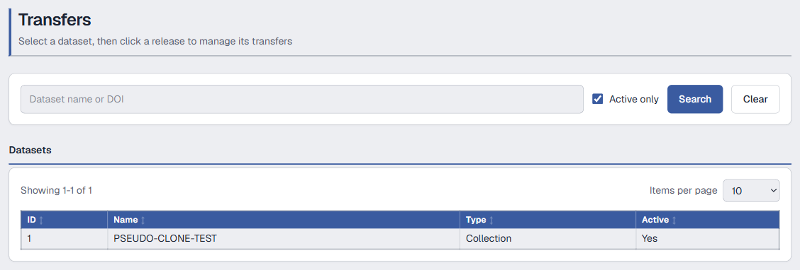
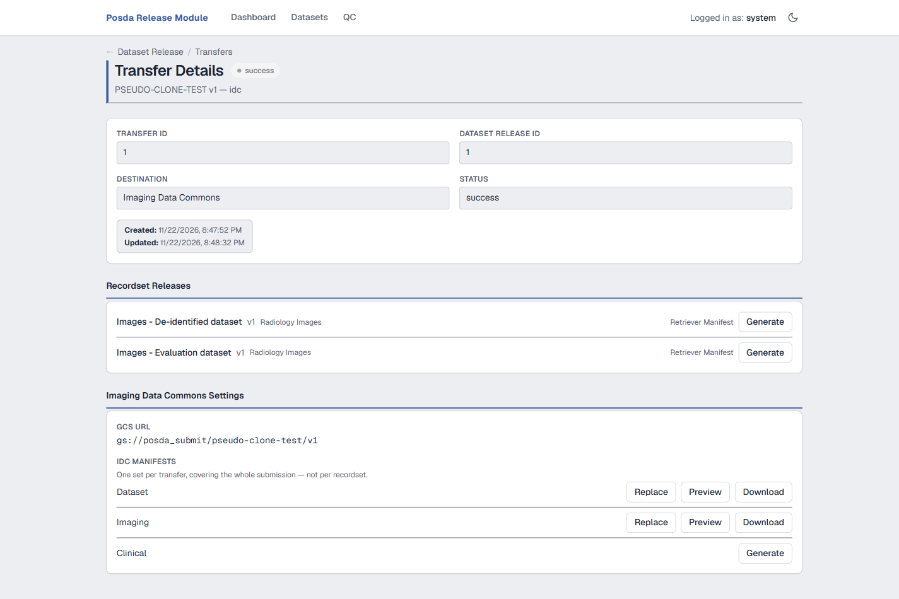

# Transfers

The transfer pages outside the cycle. Use the cycle's
[Transfer stage](09-cycle-transfer.md) for normal work; these pages are for
looking up a transfer directly.

## The transfer list

**Where:** `/release/transfers` <!-- Q: no navbar link; see QUESTIONS.md Q14 -->

<!--  -->

1. Find the dataset with **Search**, ticking **Active only** if you like.
2. Click the dataset. Its releases appear below.
3. Click a release to see its transfers.

## A release's transfers

**Where:** dataset release page → **Transfers**
(`/release/datasets/releases/:release_id/transfers`)

Lists each transfer's **Name**, **Destination** and **Status**. From here you
can:

- click a row to open the transfer,
- **New Destination Transfer** — create a transfer by hand,
- sync transfers with the release's contents,
- **Delete** a transfer (click **Confirm** to finish).

> **Tip:** The cycle's Transfer stage creates and syncs transfers for you, one
> per destination. Prefer it.

## The transfer page

**Where:** `/release/transfers/:transfer_id`

<!--  -->

- **Details** — transfer ID, dataset release, destination, status, notes.
- **Recordset Releases** — what it carries, with per-recordset manifest
  generation and **Download**.
- **<Destination> Settings** — the same settings as the cycle's **Manage**
  dialog. See [Configuring a transfer](09-cycle-transfer.md#configuring-a-transfer).

## The dataset release page

**Where:** dataset page → **Releases** → click a release
(`/release/datasets/releases/:release_id`)

Shows the release's number, status, date and notes, with **Transfers** and
**Edit Release** buttons. Its **Recordset Releases** section lists the
**Available Recordset Releases** and those **Added to Dataset Release**, with
checkboxes to move them between the two.

> **Note:** During a cycle, change a release's contents in
> [Assemble](06-cycle-assemble.md) and [Bundle](08-cycle-bundle.md) instead.
> They apply the same checks the cycle relies on.

## Related

- [Transfer](09-cycle-transfer.md)
- [Back to contents](README.md)
