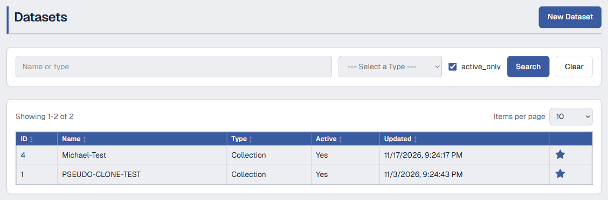

# POSDA Release Module — User Manual

How to take a dataset from changed source data to a published, distributed
release using the Release Module (`/release/` in Posda).

> **Status:** draft. All chapters are written from the current code; screenshots
> are still to come, and open questions are in [QUESTIONS.md](QUESTIONS.md).

## Contents

| # | Chapter | What it covers |
|---|---|---|
| 00 | [Getting started](00-getting-started.md) | Logging in, the navbar, Home, the Dashboard |
| 01 | [Concepts](01-concepts.md) | Datasets, recordsets, drafts, releases, QC, transfers. Includes a glossary |
| 02 | [Datasets](02-datasets.md) | Finding, creating, and viewing datasets |
| 03 | [Recordsets](03-recordsets.md) | Recordsets, their drafts and releases |
| 04 | [The release cycle](04-cycle-overview.md) | The six stages and how to move between them |
| 05 | [Setup](05-cycle-setup.md) | Stage 1: get a dataset ready and start a cycle |
| 06 | [Assemble](06-cycle-assemble.md) | Stage 2: build recordset drafts |
| 07 | [Verify](07-cycle-verify.md) | Stage 3: QC reviews |
| 08 | [Bundle](08-cycle-bundle.md) | Stage 4: publish releases |
| 09 | [Transfer](09-cycle-transfer.md) | Stage 5: send to IDC, NBIA, Aspera, CRDC |
| 10 | [Disseminate](10-cycle-disseminate.md) | Stage 6: WordPress pages and downloads |
| 11 | [QC queue & reviews](11-qc.md) | Working QC outside the cycle |
| 12 | [Transfers](12-transfers.md) | The transfer list and detail pages |
| 13 | [Troubleshooting](13-troubleshooting.md) | Common errors and what to do |

Training exercises are in [../training/](../training/README.md).

## Writing conventions

- **Steps** are numbered, one action each. Name a button or field by its
  on-screen label in **bold**: "Click **Start Next Cycle**."
- **Screenshots** go in `images/<chapter>/` and use the pattern
  `NN-short-description.png` (for example `images/datasets/01-list.png`).
  Reference them with a relative path:

  ```markdown
  
  ```

- Crop each screenshot to the part of the screen the step is about. Take it
  in light theme so the set stays consistent.
- Don't put real patient data or anything sensitive in a screenshot. Use the
  training dataset.
- Use `> **Note:**`, `> **Tip:**` and `> **Warning:**` for callouts.
- Copy [_TEMPLATE.md](_TEMPLATE.md) to start a new section.
- Screenshot slots are commented out (`<!--  -->`). Uncomment
  them once the image file exists.
- Open questions are marked `<!-- Q… -->` in the text and collected in
  [QUESTIONS.md](QUESTIONS.md).
