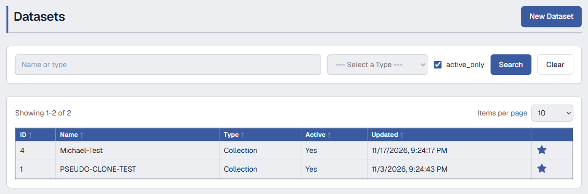

# Writing conventions

How the manual is written and maintained. Back to the [manual](README.md).

- **Steps** are numbered, one action each. Name a button or field by its
  on-screen label in **bold**: "Click **Start Next Cycle**."
- **Screenshots** go in `images/<chapter>/` and use the pattern
  `NN-short-description.png` (for example `images/datasets/01-list.png`).
  Reference them with a relative path:

  ```markdown
  
  ```

- Crop each screenshot to the part of the screen the step is about. Take it
  in light theme so the set stays consistent.
- Don't put real patient data or anything sensitive in a screenshot. Use the
  training dataset.
- Use `> **Note:**`, `> **Tip:**` and `> **Warning:**` for callouts.
- Copy [_TEMPLATE.md](_TEMPLATE.md) to start a new section.
- Screenshot slots are commented out (`<!--  -->`). Uncomment
  them once the image file exists. [SCREENSHOTS.md](SCREENSHOTS.md) lists
  every slot in capture order.
- Open questions are marked `<!-- Q… -->` in the text and collected in
  [QUESTIONS.md](QUESTIONS.md).
