# WP_UPDATES.md — WordPress updates for versioning

What the TCIA WordPress site (Collection Manager / Pods) needs so that Posda's
dataset and recordset versioning can drive it. Started 2026-09-24.
**Direction agreed 2026-10-06 (Jeff's publish-to-master model, option A4); details
pending a staging prototype.** See [section 11](#11-2026-10-06-meeting-direction);
Michael's follow-up proposal is [section 12](#12-proposal-version-pods-at-both-levels).
Sections 5–8 are the options as first written up, kept for the record.

Shared pages (private until shared from each page's Share menu):
- Original options write-up (sections 1–10):
  https://claude.ai/artifact/Trs8eft514uaTGGQKQHv5P
- 2026-10-06 meeting: decision and open questions (section 11):
  https://claude.ai/artifact/NPsJ8om2gomw9s3oNQXyVk
- Proposal: version pods at both levels (section 12):
  https://claude.ai/artifact/AhVTpWqpsX2cDEKhag1Pf6

Sources: the **Pods export** (Pods 2.9.19.5, taken 2026-09-24), live REST
responses from `https://www.cancerimagingarchive.net/api/v1/…`, and
`oneposda/.../papi/util/wp.py`.

## Contents

1. [The two needs](#1-the-two-needs)
2. [Posda's release model](#2-posdas-release-model)
3. [WordPress today](#3-wordpress-today)
4. [Why today's setup can't meet the needs](#4-why-todays-setup-cant-meet-the-needs)
5. [Need A — draft the next version](#5-need-a--draft-the-next-version-without-touching-the-live-one)
6. [Need B — version the downloads](#6-need-b--version-the-downloads-recordsets)
7. [Putting them together](#7-putting-them-together)
8. [Worked example](#8-worked-example-a3--b3)
9. [Open questions](#9-open-questions)
10. [Side notes on `wp.py`](#10-side-notes-on-oneposda-wppy)
11. [2026-10-06 meeting: direction](#11-2026-10-06-meeting-direction)
12. [Proposal: version pods at both levels](#12-proposal-version-pods-at-both-levels)

---

## 1. The two needs

- **A — Draft the next version without touching the live one.** Curators need
  to prepare version N+1 of a collection in WordPress (text, downloads, counts)
  while version N stays public and unchanged. Then it all goes live at once.
- **B — Version the downloads (recordsets).** In Posda each recordset (Imaging,
  Clinical, …) has its own releases. WordPress versions only the collection
  page, so a download has no version, no history, and no way to be carried
  forward unchanged into the next collection version.

## 2. Posda's release model

The shape everything below is measured against. Four tables, two kinds of link:

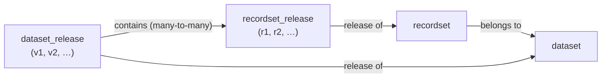

- **Ownership:** a recordset belongs to one dataset (`recordset.dataset_id`).
- **Release of:** each release points at the thing it's a release of
  (`dataset_release.dataset_id`, `recordset_release.recordset_id`).
- **Composition:** a dataset release contains specific recordset releases
  (`dataset_release_recordset`). An unchanged recordset is *carried forward*:
  the same recordset release sits in both v1 and v2.

The dataset never points at a recordset *release*, and a dataset release never
points at a *general* recordset. You get from one to the other by going around
the square.

## 3. WordPress today

Every pod is a `post_type` with `storage: meta`, REST namespace `v1`. Media is
core WP. **⇄** marks a two-way ("sister") Pods relationship: writing one side
updates the other.

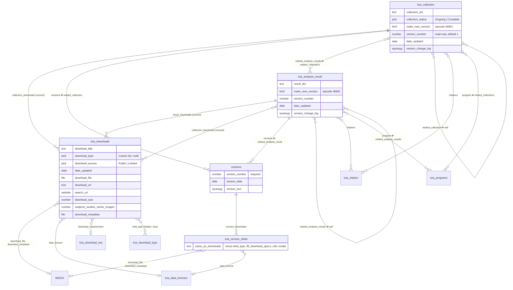

**Descriptive lookups aren't drawn above.** They are all post-type picks,
returned over REST as **names**, not IDs: `tcia_cancer_type`,
`tcia_cancer_location`, `tcia_species`, `tcia_data_type`, `tcia_file_type`,
`tcia_supporting_data`. Other extras: the `tcia_headings` taxonomy and the
`tcia_collections_settings` settings page.

### How versioning works today

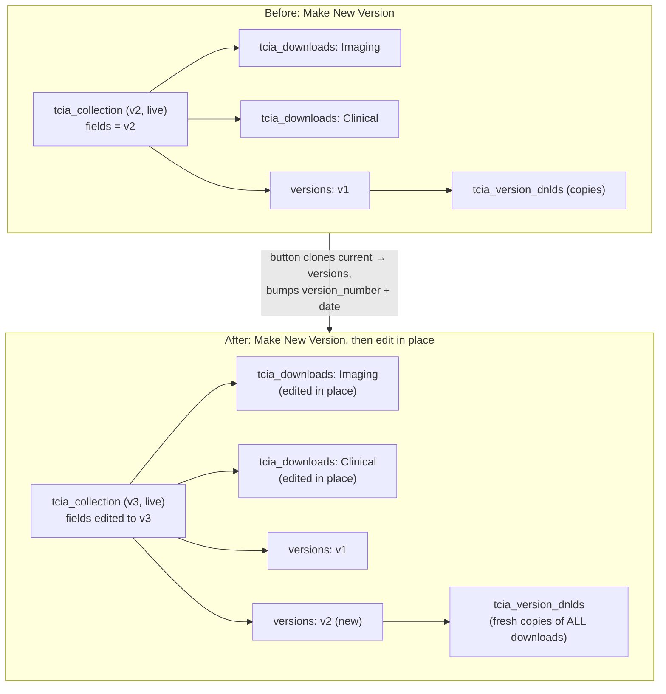

- **The collection post *is* the current version.** It holds `version_number`
  (a plain integer), `date_updated` and `version_change_log`. Its current
  downloads hang off `collection_downloads` / `result_downloads`.
- **Make New Version is a button** (WPCode snippet 46851). It clones the current
  state into a `versions` post plus copies of every download
  (`tcia_version_dnlds`), then bumps the number and date. Curators then edit the
  live post in place.
- **A previous version is a copy.** `tcia_version_dnlds` is a separate post type
  with nearly the same fields as `tcia_downloads`, so every archive duplicates
  every download under new IDs, changed or not.
- **Downloads have no back-link and no version.** The page → download pick only
  goes one way, so a download doesn't know which page it's on. One download can
  also appear on several pages: an analysis result lists other collections'
  downloads in `collection_downloads`.

### Posda ↔ WordPress mapping today

| Posda | WordPress | Linked via |
|---|---|---|
| `dataset` | `tcia_collection` / `tcia_analysis_result` | `wp_object_map` |
| `recordset` | `tcia_downloads` | `wp_object_map` |
| `file` | media attachment | `wp_object_map` (avoids uploading the same file twice) |
| `dataset_release` | — *(deferred)* | — |
| `recordset_release` | — *(deferred)* | — |

## 4. Why today's setup can't meet the needs

A WordPress post has **one** set of field values. A published post shows its
fields as they are right now, and saving changes to it is instantly public.

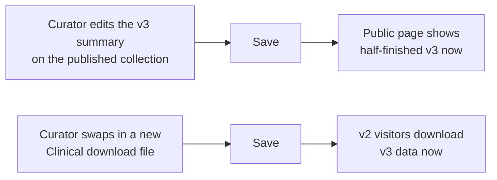

- **Need A fails** because there's nowhere to keep v3 while v2 stays live.
  "Make New Version" only archives the old state. The new state is still built
  by editing the live post.
- **Need B fails** because a download is edited in place, has no release number,
  and each dataset version gets its own full copy instead of reusing unchanged
  releases.

---

## 5. Need A — draft the next version without touching the live one

### A1 — Keep the draft in Posda (no WordPress changes)

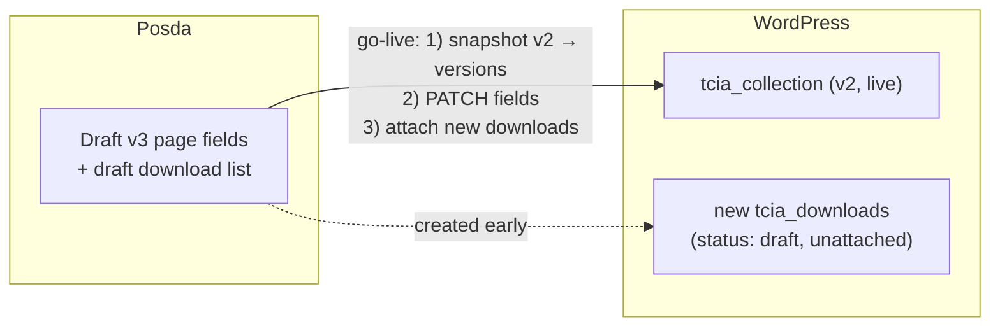

- **What changes in WordPress:** nothing.
- **How it works:** Posda holds the next version's page fields and download
  list. New download posts are created as drafts and left unattached. At
  go-live, Posda does over REST what the button does today (create the
  `versions` post and `tcia_version_dnlds` copies), then PATCHes the live
  collection and attaches the new downloads.
- **Pros:** zero WordPress work. Posda is in full control of timing.
- **Cons:** curators can't edit or preview the next version in WordPress.
  Posda would need editors for fields WordPress already has (summary, methods,
  acknowledgements…). Go-live is several separate writes, so a failure partway
  leaves a mix of old and new.

### A2 — Shadow draft post, "rewrite and republish" (small WordPress change)

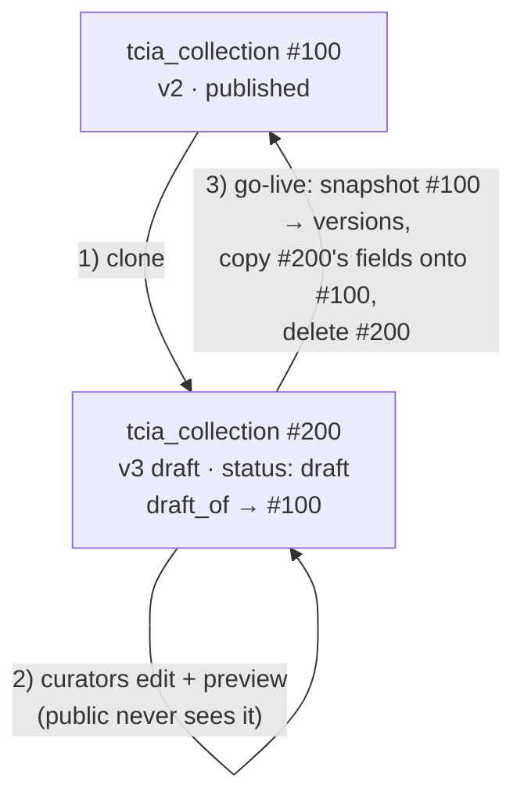

- **What changes in WordPress:** add a `draft_of` pick (collection → collection,
  and the same on `tcia_analysis_result`). Downloads that change get the same
  treatment, so also add `draft_of` on `tcia_downloads`.
- **How it works:** clone the live post into a draft copy. Curators edit and
  preview the copy like any WordPress post. At go-live the live post is
  snapshotted into `versions` (what the button does today), the copy's fields
  are written onto the live post, and the copy is deleted. The live post keeps
  its ID, slug, URL and DOI landing page. The Yoast Duplicate Post plugin
  ("Rewrite & Republish") does this if it's installed or can be. Posda could
  also do it over REST.
- **⚠ Two-way relationships.** If the clone sets `program`,
  `related_analysis_results` or `related_collection`, Pods also adds the clone
  to the *other* side's list, so a draft would show up on the Program page and
  on related collections. The clone must leave those fields empty, and go-live
  keeps the live post's values.

  ```mermaid
  flowchart LR
      CL["Draft clone #200"] -- "program = CPTAC" --> PR["tcia_programs: CPTAC"]
      PR -- "sister auto-adds #200 to<br/>related_collections" --> CL
      PR --> X["CPTAC program page now<br/>lists a draft ✗"]
  ```
- **Pros:** real drafting and preview in WordPress, the existing templates
  keep working, and the snapshot logic already exists.
- **Cons:** it's still copy-based (snapshots duplicate downloads). The
  two-way-relationship rule has to be enforced by whatever makes the clone.
  Merging the copy back is a field-by-field write.

### A3 — Versions become real pages (restructure)

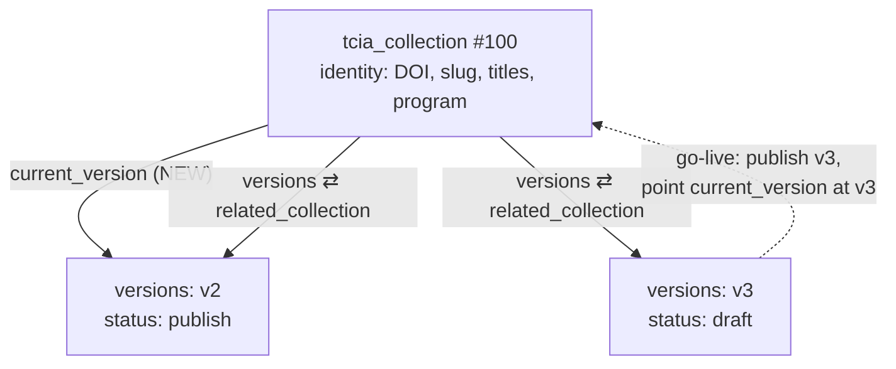

- **What changes in WordPress:**
  - `tcia_collection` / `tcia_analysis_result` keep only **identity** fields:
    DOI, slug, titles, featured image, program, related pages, and possibly
    citations.
  - Fields that change per version **move to `versions`**: downloads, version
    number, date, change log, subject count, and whichever text fields should be
    versioned (see [open question 3](#9-open-questions)).
  - New `current_version` pick on the collection → `versions` (single).
  - **The page templates change** to render from `current_version` instead of
    the collection's own fields.
- **How it works:** the next version is simply a new `versions` post in draft.
  Curators edit and preview it. Go-live publishes it and moves one pointer.
  Rolling back means moving the pointer back. Nothing is copied.
- **Pros:** drafting is native. Go-live is one atomic switch. Previous versions
  can show their full page, not just their downloads. It matches Posda's
  `dataset` / `dataset_release` exactly.
- **Cons:** templates must be rewritten (they aren't in the Pods export).
  Existing data needs migrating (the [migration sketch](#migration-sketch-a3--b3)
  is below). This is the biggest change.

---

## 6. Need B — version the downloads (recordsets)

### B1 — Posda owns recordset versions (no WordPress changes)

- **Mapping:** `recordset` → the live `tcia_downloads` post.
  `recordset_release` → the `tcia_version_dnlds` copy made when that release was
  archived.
- **How it works:** the same as today. The live download is edited in place,
  and the snapshot copies it into `tcia_version_dnlds`. Posda knows which
  release each post represents and WordPress doesn't.
- **Pros:** nothing to build in WordPress.
- **Cons:** every dataset version copies *every* download, changed or not.
  WordPress never shows a recordset's own version, and the live download is
  still edited in place (so it needs A1 or A2 to draft safely).

### B2 — Label the downloads (small WordPress change)

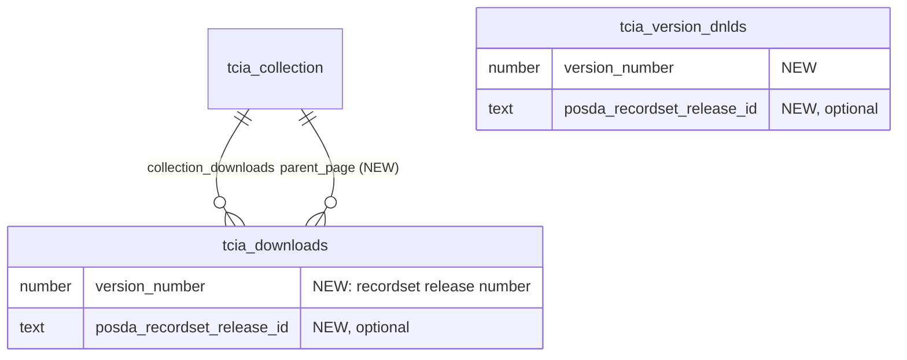

- **What changes in WordPress:** on both download pods, add a `version_number`
  (the recordset's own release number) and a `parent_page` pick (the missing
  back-link). Optionally add the Posda recordset release ID for matching.
- **How it works:** B1's behavior, but the page can show "Imaging r1 ·
  Clinical r3", and every download knows its page.
- **Pros:** small and additive, with no template rewrite needed (the label is
  optional to display).
- **Cons:** still copy-based. An unchanged recordset gets a fresh copy with
  every dataset version.

### B3 — Split downloads into identity + release (restructure)

The same split as A3, applied to downloads:

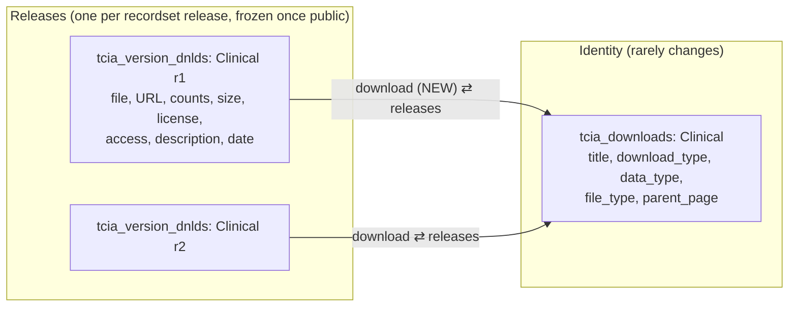

- **What changes in WordPress:**
  - `tcia_downloads` keeps only **identity**: title/slug, `download_type`,
    `data_type` / `file_type`, `parent_page` (NEW), and optionally the Posda
    recordset ID.
  - `tcia_version_dnlds` becomes **the release**: it keeps all its current
    content fields and gains a `download` pick back to its identity post plus a
    `version_number` (the recordset's own release number).
  - `versions.version_downloads` **already points at `tcia_version_dnlds`**, so
    that link doesn't change.
- **How it works:** a new recordset release is a new draft
  `tcia_version_dnlds` post. It's attached to the draft `versions` post and
  published at go-live. A recordset carried forward unchanged is just listed
  again: the same release post sits in both v1's and v2's `version_downloads`.
  A release is never edited after it's public.
- **Don't add a "current release" pointer on `tcia_downloads`.** The collection's
  current version already says which release of each recordset is live. A
  second pointer is a second source of truth that can disagree.
- **Analysis results that reuse a collection's download** should point at a
  specific `tcia_version_dnlds` (the release the analysis actually used), not
  the identity post, which would silently follow the latest release.
- **Pros:** no duplication, drafts come free, and "Clinical: r1 → r2 → r3"
  history is possible. It matches Posda's `recordset` / `recordset_release`
  exactly. It builds on the existing previous-versions data instead of
  replacing it.
- **Cons:** needs A3 to be tidy (without a `current_version` pointer, the page
  has to list release posts directly). Needs migration and template changes.

---

## 7. Putting them together

The A and B options pair naturally:

| | **A1 + B1** "Posda does it" | **A2 + B2** "minimal WordPress change" | **A3 + B3** "WordPress mirrors Posda" |
|---|---|---|---|
| WordPress schema changes | none | `draft_of` on 3 pods; `version_number` + `parent_page` on 2 download pods | collection/download pods slimmed to identity; `current_version`, `download`, `version_number` added |
| Template changes | none | none | collection, analysis-result and download templates |
| Data migration | none | none (new fields start empty) | yes (sketch below) |
| Draft editing & preview in WordPress | ✗ (Posda UI) | ✓ | ✓ (native) |
| Go-live | several writes by Posda | merge draft copy into the live post | publish + move one pointer |
| Rollback | manual | manual | move the pointer back |
| Unchanged downloads copied per version | yes | yes | no, reused |
| Recordset version visible on the site | no | yes (label) | yes (real history) |
| Two-way-relationship risk | low | **must be managed** | low |
| Fit with Posda's model | loose | close | exact |

**Recommendation:**
- **A2 + B2** if the goal is the smallest change that meets both needs. It gives
  real drafts in WordPress, keeps every template, and needs no data migration.
- **A3 + B3** is the correct end state. WordPress and Posda would have the same
  structure, there are no copies to keep in sync, and go-live and rollback are a
  single switch.
- A2 + B2 → A3 + B3 is a reasonable path too. B2's `parent_page` and
  `version_number` fields carry straight over into B3.

> **2026-10-06:** A3's pointer was considered and rejected. The versions would
> have to be public, search/indexing/caching need the fields stored on the
> master post, and Jeff's code would need a rewrite. The team went with **A4**
> instead; see [section 11](#11-2026-10-06-meeting-direction).

### How Posda maps under each

| Posda | A1 + B1 | A2 + B2 | A3 + B3 |
|---|---|---|---|
| `dataset` | `tcia_collection` | `tcia_collection` | `tcia_collection` (identity) |
| `dataset_release` | `versions` (on archive) | `versions` (on archive) | `versions` (**draft → current**) |
| `recordset` | `tcia_downloads` | `tcia_downloads` | `tcia_downloads` (identity) |
| `recordset_release` | `tcia_version_dnlds` (on archive) | `tcia_version_dnlds` (on archive) | `tcia_version_dnlds` (**the release**) |

### Go-live under A3 + B3

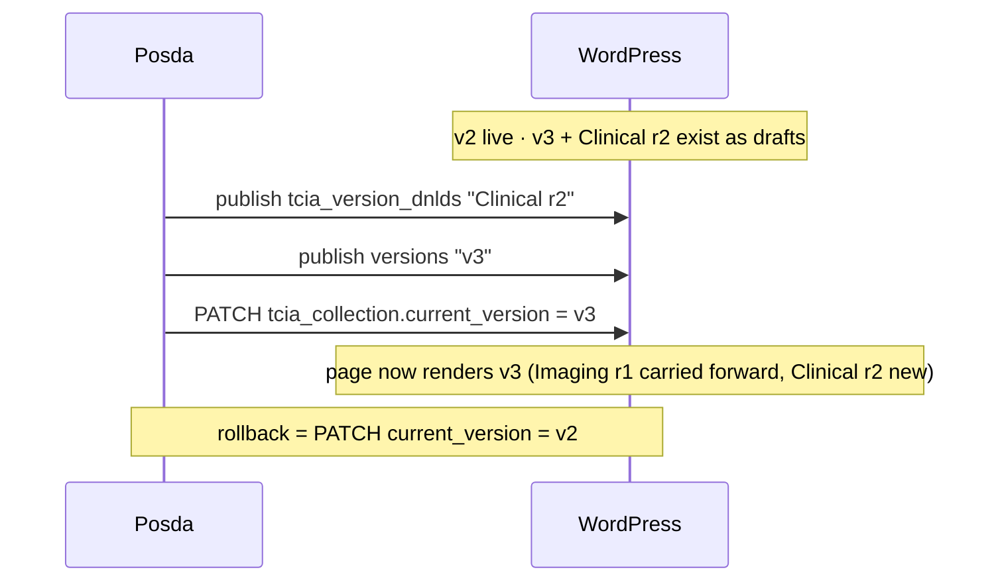

### Migration sketch (A3 + B3)

1. **Collections:** for each collection / analysis result, create a
   `versions` post from its current fields (version number, date, change log,
   downloads, and any other fields that move) and set `current_version` to it.
2. **Downloads:** for each `tcia_downloads` post, create a
   `tcia_version_dnlds` release holding its current content, point the release's
   `download` back at it, then strip it down to identity fields. Put the new
   release in the new current `versions` post from step 1.
3. **Existing previous versions:** their `version_downloads` already point at
   `tcia_version_dnlds`, so they keep working. They were copies with no
   back-link, so linking them to an identity post means matching by title and
   collection. Leaving old ones unlinked is an acceptable fallback, since the
   link can be optional.
4. **Analysis results:** repoint `collection_downloads` at the specific
   `tcia_version_dnlds` releases they used.
5. **Templates:** switch collection, analysis-result and download rendering to
   read through `current_version`.

---

## 8. Worked example (A3 + B3)

TCGA-XYZ has two recordsets, Imaging and Clinical. v2 changes only Clinical.

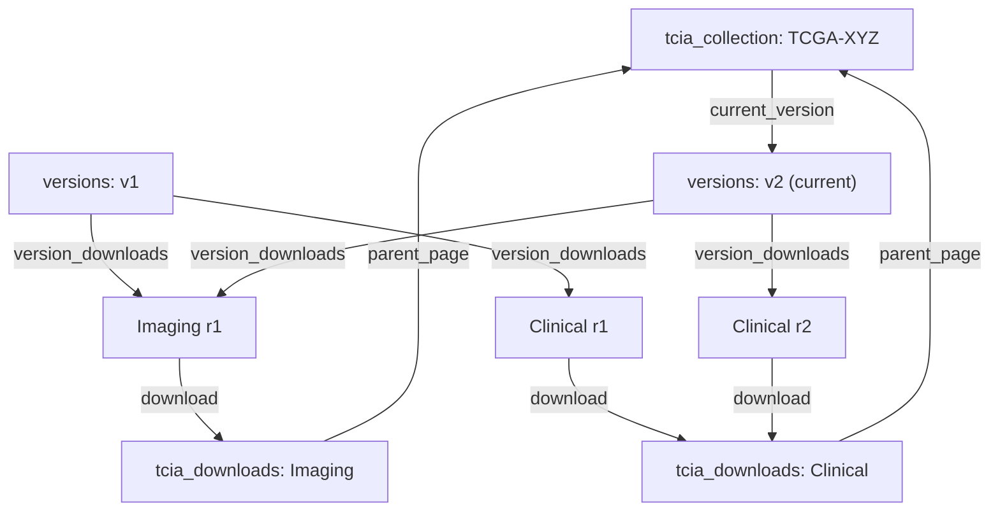

| Post | Links to |
|---|---|
| `tcia_downloads` "Imaging" | `parent_page` → TCGA-XYZ |
| `tcia_downloads` "Clinical" | `parent_page` → TCGA-XYZ |
| `tcia_version_dnlds` "Imaging r1" | `download` → Imaging |
| `tcia_version_dnlds` "Clinical r1" | `download` → Clinical |
| `tcia_version_dnlds` "Clinical r2" | `download` → Clinical |
| `versions` "v1" | `version_downloads` → Imaging r1, Clinical r1 |
| `versions` "v2" | `version_downloads` → Imaging r1, **Clinical r2** |

**Which link answers which question:**
- *What does the public page show?* collection → `current_version` →
  `version_downloads`. This is the only path the page needs.
- *What recordsets does this collection have?* `tcia_downloads` whose
  `parent_page` is the collection.
- *What's the history of Clinical?* releases whose `download` is Clinical:
  r1, r2.

The collection → general recordset link only says "these belong to me". Which
release is live always goes through the version.

---

## 9. Open questions

1. ~~**Are Yoast Duplicate Post or PublishPress Revisions installed, or
   allowed?**~~ *Moot (2026-10-06): A4 clones into its own pod, and Jeff's hook
   does the publish.*
2. **Do the templates show a download that's attached but still in draft
   status?** The download picks accept any status. If drafts are hidden,
   attaching new downloads early is safe, which helps A1 and A2.
3. ~~**Which collection fields are per-version?**~~ *Answered (2026-10-06):
   all of them. The version pods are full clones ("holistic" versioning).*
4. **Who can change the Pods templates** (Collection Template A, Analysis
   Result Template A, list templates)? Jeff. Under A4 they don't change for the
   live page; a previous-version view is new work.
5. ~~**DOIs:** does a version ever get its own DOI?~~ *Answered (2026-10-06):
   yes, Justin wants a DOI per dataset version; the parent DOI always resolves
   to the newest. Not for recordset releases. How a version DOI resolves is
   open; see [11.3](#113-open).*

Questions raised on 2026-10-06 are in [11.3](#113-open).

## 10. Side notes on `oneposda` `wp.py`

- **`dcid_type` — to explore.** `format_download` reads it and has done so since
  `wp.py` was created (commit `59e06257`, 2026-05-21). No pod defines it, none
  of 100 live download records has the key, and nothing reads it. The nearest
  real field is `dnld_type` (the hidden "Download Type (new)" pick →
  `tcia_download_type`), which is `false` on all 100 sampled records. Probably
  a typo or leftover of `dnld_type`.
- `versions.related_collection` / `related_analysis_result` come back as a
  **name**, not an ID. Resolve a version's parent through the parent's
  `versions` list instead.
- Known and fine: download `cancer_type` / `cancer_location` / `species` are
  not readable over REST (always null). Version downloads lack
  `fill_download_specs` and `display_cdrc_modal_dialog`, so those keys come back
  empty.

---

## 11. 2026-10-06 meeting: direction

Attendees: Michael, Jeff (WordPress), Tracy (curation, left early).

### 11.1 Decision: A4, "version pods + publish to master"

Jeff's model. It sits between A2 and A3: the drafts live in their own pod (like
A3's versions), but the live page is still a full copy on the collection post
(like A2), so nothing that reads the live page changes.

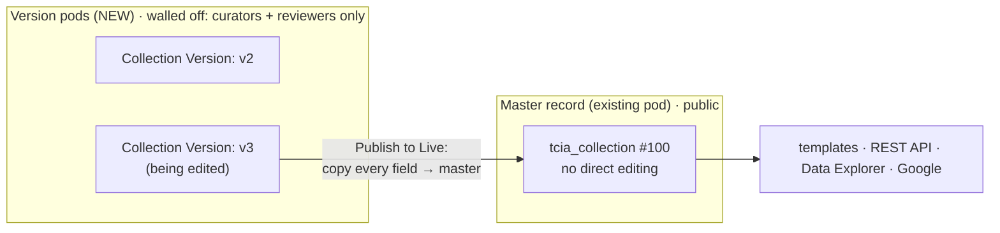

- **New pods:** "Collection Versions" and "Analysis Result Versions", made by
  **cloning** the existing pods, so they have every field (Jeff has a lot of
  JavaScript tied to the pod settings; cloning beats rebuilding them on
  `versions`).
- **Holistic versioning:** every field is versioned, DOI and short title
  included, so a diff between versions can cover anything. No deciding which
  fields count.
- **Master record** = the existing `tcia_collection` / `tcia_analysis_result`
  post. Templates, API, Data Explorer and search keep reading it unchanged.
  Nobody edits it directly; it is only written by Publish to Live.
- **Editing a version:** curators edit a version record in a form that looks
  like today's. Reviewers (e.g. Ramesh) get a non-public preview. Comments can
  live on the version record and are never copied to the master.
- **Republish without re-versioning:** a version can be tweaked and published
  again as often as needed ("stone tablet"). A new version number only happens
  when someone explicitly makes a new version. This answers Tracy's concern
  about finalize churn producing dozens of versions.
- **Rollback** = publish an older version record.
- **Not WordPress "draft" status.** Version records are published posts in a
  walled-off post type. Jeff can lock down a whole post type, but not single
  records inside the live pod.
- **Downloads:** a new version links the *same* download records as the one it
  was made from. A changed download is duplicated and the copy is changed; a
  removed one is unlinked. Unchanged downloads are never copied.
- **Publish runs inside WordPress.** Jeff writes a PHP hook that does the whole
  publish; Posda's button calls it. That keeps it one transaction that can be
  rolled back, instead of several REST writes from Posda.
- **Everything stays in WordPress** (A1 is out): not all data goes through
  Posda.

Rejected: **A3's pointer** (see the note under section 7).

### 11.2 Agreed in passing

- Recordset **version numbers are on hold** for WordPress. Posda tracks
  recordset releases itself, as long as each one links to the right download
  record. Jeff can add a WordPress field later if needed.
- Previous versions stay downloadable by the public: researchers cite a version
  (e.g. "CMB-MML v6") and need its files. Jeff's idea: a version picker on the
  live page that renders the chosen version on a temporary page.
- Merging the collection and analysis-result structures was raised and dropped.
- Fill Download Specs from NBIA will be replaced by Posda pushing the counts.

### 11.3 Open

1. **Version DOIs vs walled-off versions.** A version DOI needs a stable public
   URL (e.g. `…/collection-slug/v1`), but a version rendered on request isn't
   one. Jeff's alternative: make the version pods public, and add a separate
   private **staging** pod for drafts. Then Publish to Live writes both the
   master record and a public version record. Jeff to test how locked down a
   walled-off post type really is.
2. **The existing `versions` pod.** A4 makes it redundant.
   - Michael: copy (ETL) its records into the new version pods.
   - Jeff: leave old versions where they are for pre-A4 history.
   - Against Jeff's option: previous versions would live in two places.
   - Against the ETL: old versions' text is unknown, so they'd be backfilled
     with today's values. They should be marked "pre-versioning" so a diff
     doesn't show false history.
3. **Where download releases live under A4 — for the next discussion.**
   It came up twice but wasn't settled:
   - Jeff (~11:11): his version records "would replace version downloads". A
     version record links its downloads directly, and `versions` +
     `tcia_version_dnlds` retire together.
   - Michael (~11:22): handle recordsets like datasets, with even the current
     release in version downloads (B3). Jeff was wary of extra records, and
     recordset versioning was put on hold.

   Options:
   - **(i) Version records link `tcia_downloads` directly.** Each download post
     becomes a frozen recordset release (a change means duplicating it). One
     download pod, but a new release sits in the public pod before go-live
     (Jeff can't wall off single records in a live pod), and WordPress has no
     recordset-level post, so `wp_object_map` must map
     `recordset_release → tcia_downloads`.
   - **(ii) A4's pattern one level down.** A walled-off pod holds download
     releases; Publish to Live copies the release onto the `tcia_downloads`
     post, which stays the public recordset. Hides unreleased downloads,
     keeps `recordset → tcia_downloads`, and adds the missing release →
     download back-link. Costs: the publish hook also writes download fields,
     and the previous-version view reads the walled-off pod (ties to item 1).
     Jeff wasn't keen on repurposing `versions`, so the release pod would
     likely be a **new clone of `tcia_downloads`** rather than a repurposed
     `tcia_version_dnlds`.

   Either way `tcia_version_dnlds`' existing records (per-version copies,
   labeled with the dataset version, no back-link) are legacy, like the old
   `versions` records in item 2.
4. **Two-way relationships on the cloned pods.** If the version pods'
   `program` / related-collection picks are set up as sister (two-way) fields,
   draft versions will appear on Program and related-collection pages (the A2
   problem). The cloned pods' picks should be one-way.
5. **Scope this quarter.** Probably planning and testing only, implementation
   next quarter. Michael's actual blocker is that Make New Version
   (WPCode 46851) copies unchanged downloads, which breaks Posda's one-to-many
   link at the dissemination step. **Stopgap:** Jeff changes 46851 to stop
   copying unchanged downloads. If that lands, implementing A4 can wait.

### 11.4 Next steps

1. Jeff: have Scott clone production to the **staging** server.
2. Jeff: upgrade Pods on staging, then production, **before** any versioning
   work. Pods is well behind (held back by the inline-PHP issue).
3. Jeff: prototype the cloned version pod and the lockdown on staging.
4. Michael: point Posda at staging to test linking.
5. Reconvene: maybe next week; plan on ~2026-10-20.

---

## 12. Proposal: version pods at both levels

**Michael's proposal for the next discussion (2026-10-07).** It builds on the
direction agreed in [section 11](#11-2026-10-06-meeting-direction) and answers
open questions 3 (where recordset versions live) and, for now, 1 (version DOIs).
Pod and field names are placeholders for Jeff to choose.

### 12.0 Two kinds of version

This proposal adds versions to **recordsets** (downloads) as well as datasets
(collections). The two numbers are independent:

- **Dataset version**: a version of the whole collection page, e.g.
  **TCGA-XYZ v3**. Posda calls it a `dataset_release`.
- **Recordset version**: a version of one download, e.g. **Clinical v2**. Posda
  calls it a `recordset_release`.

A dataset version is made of specific recordset versions. TCGA-XYZ v3 might be
Imaging v1 + Clinical v2 + Pathology v1. A recordset that doesn't change keeps
its version number and is carried into the next dataset version as-is. That's
Tracy's example from the meeting: a collection at v15 whose pathology hasn't
changed since collection v10.

### 12.1 The idea in one picture

Apply the pattern agreed for collections a second time, one level down. At both
levels a **public, locked post is the anchor** that everything reads, and a
**walled-off pod holds the versions** that curators edit. Publish to Live copies
a version onto its anchor.

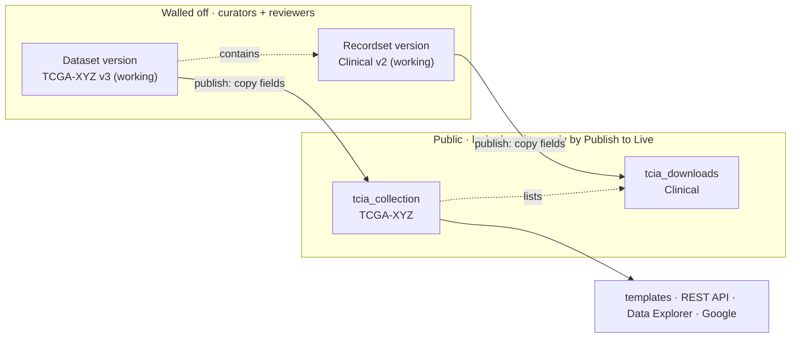

| Level | Anchor (public, locked) | Versions (walled off) |
|---|---|---|
| Dataset | `tcia_collection` / `tcia_analysis_result` | **Collection Versions** / **Analysis Result Versions** (new clones) |
| Recordset | `tcia_downloads` | **Download Versions** (new clone of `tcia_downloads`) |

Why an anchor at the recordset level: curators think of "the Clinical download"
as one thing. Keeping `tcia_downloads` as that one thing, with its versions
hanging off it, is what they'd expect, and it's the same pattern they'll use for
collections. Nothing existing is repurposed; `versions` and `tcia_version_dnlds`
retire (see [12.10](#1210-existing-data)).

### 12.2 The pods

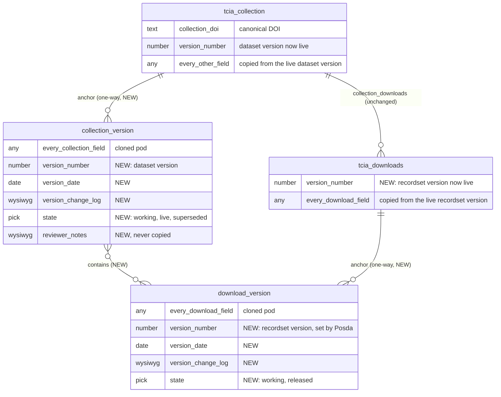

`collection_version` holds dataset versions; `download_version` holds recordset
versions. Analysis results get the same pair (`tcia_analysis_result` ↔ Analysis
Result Versions), with `result_downloads` and the reused `collection_downloads`
both pointing at Download Versions on the version side.

Changes to the cloned pods:
- The downloads pick (`collection_downloads` / `result_downloads`) on a dataset
  version points at **Download Versions**, not at `tcia_downloads`. A dataset
  version must list recordset *versions*, or editing a download would rewrite
  its history.
- Every pick is **one-way**. If `program` or the related-collection picks stayed
  two-way (sister) fields, working versions would appear on Program and
  related-collection pages ([11.3 item 4](#113-open)).
- New fields: the anchor link, version number, date and change log, a state,
  and reviewer notes.

The anchor pods (`tcia_collection`, `tcia_analysis_result`, `tcia_downloads`)
change only in permissions, plus a `version_number` on `tcia_downloads` so the
live page can show "Clinical v2". Curators can't edit anchors; only the publish
hook writes to them.

### 12.3 The rules

1. **A dataset version lists recordset versions, never anchors.** The live
   collection lists anchors, so templates and Data Explorer keep working
   unchanged.
2. **Every recordset version links its anchor.** This is the back-link that's
   missing today between a version download and its download.
3. **Only the publish hook writes to anchors.**
4. **Anything an older dataset version uses is frozen.** The live dataset
   version, and any recordset version used only by it, can be tweaked and
   republished ("stone tablet") without a new version number. A recordset
   version that an earlier dataset version also lists can't be edited, because
   that would change the earlier one. Changing it means making the next
   recordset version.

A dataset version's states:

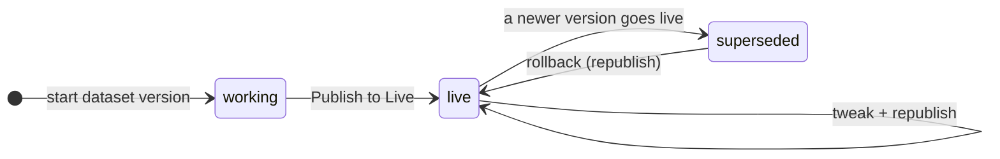

A recordset version is `working` until the first dataset version that contains
it goes live, then `released`. Rule 4 decides whether a released one can still
be tweaked.

### 12.4 A dataset version's lifecycle

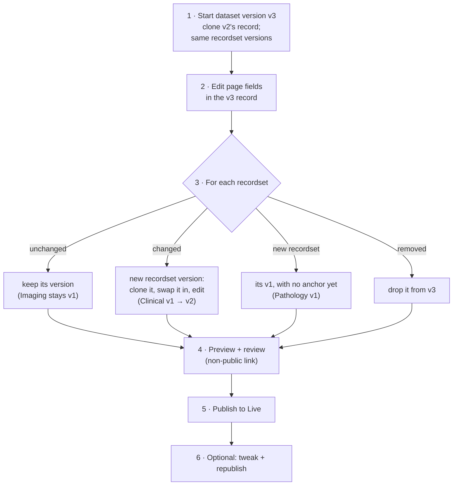

- **A brand-new recordset** has no anchor until its first publish. The hook
  creates the `tcia_downloads` post then, so nothing unreleased ever appears in
  a public pod.
- **A brand-new collection** works the same way: v1 is drafted as a dataset
  version record, and the first publish creates the `tcia_collection` post.
  (Today new collections are drafted in `tcia_collection` itself, with draft
  status.)

### 12.5 Publish to Live

One hook, run inside WordPress as a single transaction, so a failure leaves the
live site untouched.

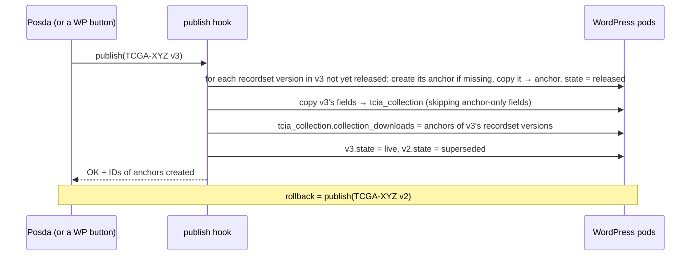

Which fields the copy skips:

| Kind | Fields | On publish |
|---|---|---|
| Versioned | title, short title, summary, abstract, methods, acknowledgements, funding, citations, cancer types, counts, file, size, … (everything else) | copied to the anchor |
| Version bookkeeping | version number, version date, change log | copied (the live page shows them, as today) |
| Anchor only | post ID, slug, **canonical DOI**, the list of versions | never overwritten |
| Version only | state, reviewer notes, the anchor link | never copied |

The canonical DOI stays on the anchor. A per-version DOI, if added later, is a
separate version-only field ([12.7](#127-previous-versions-on-the-public-site)).

### 12.6 Worked example

TCGA-XYZ starts with Imaging and Clinical. Dataset v2 changes only Clinical.
Dataset v3 adds Pathology.

| Dataset version | Imaging | Clinical | Pathology |
|---|---|---|---|
| TCGA-XYZ v1 | v1 | v1 | — |
| TCGA-XYZ v2 | v1 | **v2** | — |
| TCGA-XYZ v3 (live) | v1 | v2 | **v1** |

Bold = a new recordset version in that dataset version. Everything else is
carried forward as-is.

The posts, by pod (each recordset version points at the anchor it's a version
of; the public collection lists the anchors):

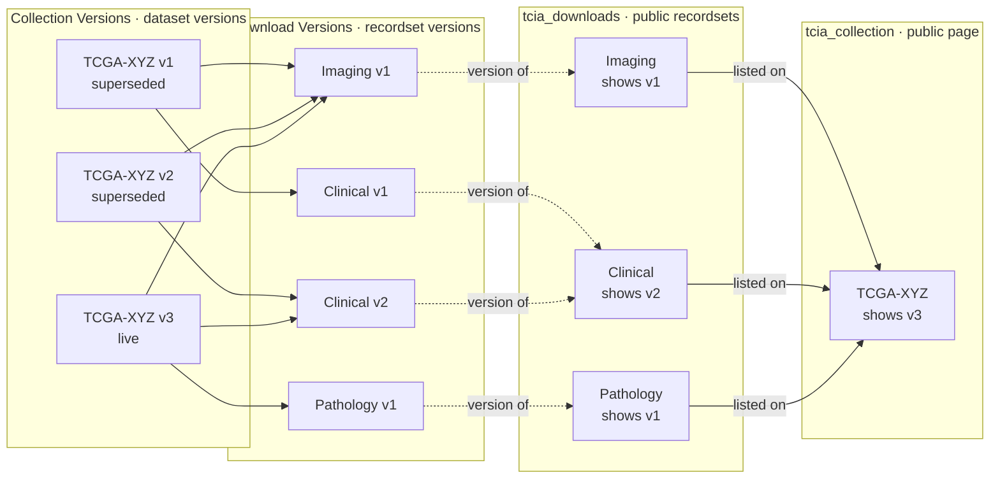

(Each dataset version also links its anchor, the TCGA-XYZ collection; left out
to keep the picture readable.)

- Imaging v1 is listed by all three dataset versions and never copied.
- Clinical v1 is frozen (v1 uses it). Clinical v2 is frozen too, since dataset
  v2 and v3 both use it. A fix to Clinical now means Clinical v3.
- The `tcia_downloads` Pathology post didn't exist until v3 was published.

**Which link answers which question:**
- *What does the public page show?* `tcia_collection` and the anchors it lists,
  as today, now labeled with their versions ("Clinical v2").
- *What was in TCGA-XYZ v2?* that record's recordset versions: Imaging v1,
  Clinical v2.
- *What's the history of Clinical?* recordset versions whose anchor is Clinical:
  v1, v2.
- *What changed between TCGA-XYZ v2 and v3?* compare the two records field by
  field; a recordset version listed in both didn't change.

### 12.7 Previous versions on the public site

- **Now (two pods):** the live page gets a version picker (Jeff's idea). Picking
  TCGA-XYZ v1 draws a page from that record and its recordset versions, with
  download links to those versions' files. Nothing in the walled-off pods is
  public by itself. The page can also show each download's own history
  ("Clinical: v1, v2").
- **Later, if Justin wants version DOIs (three pods):** the publish hook also
  writes a public page per dataset version, with a version DOI on it. Every
  version is already kept in full, so this is one more write in the hook plus a
  one-time copy of existing versions. Nothing in 12.2–12.6 changes.

### 12.8 How Posda maps

| Posda | WordPress | `wp_object_map` |
|---|---|---|
| `dataset` | `tcia_collection` / `tcia_analysis_result` (anchor) | as today |
| `dataset_release` (dataset version) | Collection / Analysis Result Version | **new** |
| `recordset` | `tcia_downloads` (anchor) | as today |
| `recordset_release` (recordset version) | Download Version | **new** (deferred until now) |
| `dataset_release_recordset` | the recordset versions a dataset version lists | — (it's the links themselves) |
| `file` | media attachment | as today |

Posda's square ([section 2](#2-posdas-release-model)) and WordPress now have the
same shape, so every Posda link has exactly one WordPress counterpart, and the
version numbers match on both sides.

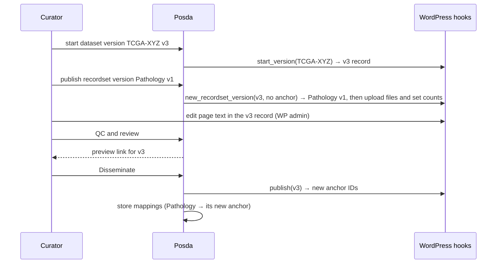

### 12.9 What Jeff would build

**Pods** (cloned, picks one-way, downloads picks retargeted):
- Collection Versions, Analysis Result Versions, Download Versions.
- `version_number` on `tcia_downloads`.
- Admin lockdown on `tcia_collection`, `tcia_analysis_result`, `tcia_downloads`.

**Hooks** (PHP, each one transaction, callable from a WP admin button and from
Posda over an authenticated REST route):

| Hook | Does | Returns |
|---|---|---|
| `start_version(anchor)` | clone the live dataset version, `state = working`, number + 1 | dataset version ID |
| `new_recordset_version(dataset_version, from?)` | clone recordset version `from` with number + 1 (or start at v1 for a new recordset) and swap it into the dataset version | recordset version ID |
| `publish(dataset_version)` | [12.5](#125-publish-to-live) | IDs of anchors created |

Dropping a recordset or reordering downloads is an ordinary edit of the dataset
version record, so it needs no hook.

**Template work:** "v2" labels on downloads if wanted; otherwise none for the
live page. The version picker and the preview page are new.

### 12.10 Existing data

1. **Current state:** for each collection, create a dataset version record from
   its current fields (`state = live`, its current version number). For each
   `tcia_downloads` post, create recordset version **v1** from its current
   fields, anchored to it and listed by that new dataset version.
2. **Old `versions` + `tcia_version_dnlds`:** still
   [11.3 item 2](#113-open). Either:
   - copy them in as `superseded` dataset versions marked "pre-versioning",
     with each `tcia_version_dnlds` post becoming a recordset version (matched
     to its anchor by title and collection; unmatched ones get no anchor).
     Recordset version numbers would have to be worked out by comparing the
     copies, since today every copy is labeled with the dataset version; or
   - leave them where they are, and have the version picker read both.

### 12.11 Phasing

| When | What | Who |
|---|---|---|
| Now | Stopgap: WPCode 46851 stops copying unchanged downloads (unblocks Posda's dissemination step under today's model) | Jeff |
| Now | Staging clone, Pods upgrade | Jeff, Scott |
| Next quarter | 12.2–12.9 on staging with Posda pointed at it, then production | Jeff, Michael |
| Later | Public dataset version pages and version DOIs (12.7) | if Justin asks |

### 12.12 Alternatives considered

| | This proposal | Freeze `tcia_downloads` (copy on change) | Repurpose `tcia_version_dnlds` as recordset versions |
|---|---|---|---|
| Recordset anchor | ✓ `tcia_downloads` | ✗ each download post is one version | ✓ |
| Unreleased downloads hidden | ✓ walled-off pod | ✗ in the public pod unless draft status | only if an existing pod can be walled off |
| Same pattern at both levels | ✓ | ✗ | partly |
| New pods | 3 | 2 | 2 |
| Repurposes an existing pod | no | no | yes (Jeff wasn't keen on that for `versions`) |

### 12.13 Questions for Jeff

1. Can Download Versions be walled off the same way as the collection version
   pods (the same test as [11.3 item 1](#113-open))?
2. Is rule 4 (anything an older dataset version uses is frozen) enforceable in
   Pods, or does it live in the hooks and admin UI?
3. Any objection to retargeting the cloned downloads picks to Download Versions?
4. On the live page, should an analysis result's reused `collection_downloads`
   follow the other collection's latest recordset version (the anchor, today's
   behavior) or the version the analysis actually used?
5. Are custom REST routes for the three hooks fine, or would you rather Posda
   trigger them another way?
