# WP_UPDATES.md — WordPress updates for versioning

What the TCIA WordPress site (Collection Manager / Pods) needs so that Posda's
dataset and recordset versioning can drive it. Started 2026-09-24.
**Undecided (November follow-up meeting): Option 1, copy versions onto the live
post, or Option 2, the live post points at a version.** See
[section 12](#12-proposal-two-options-for-version-pods). The 2026-10-06 direction
(Jeff's publish-to-master model, A4) is [section 11](#11-2026-10-06-meeting-direction);
Option 1 is that model.
Sections 5–8 are the options as first written up, kept for the record.

Shared pages (private until shared from each page's Share menu):
- Original options write-up (sections 1–10):
  https://claude.ai/artifact/Trs8eft514uaTGGQKQHv5P
- 2026-10-06 meeting: decision and open questions (section 11):
  https://claude.ai/artifact/NPsJ8om2gomw9s3oNQXyVk
- Proposal: two options for version pods (section 12):
  https://claude.ai/artifact/AhVTpWqpsX2cDEKhag1Pf6

Sources: the **Pods export** (Pods 2.9.19.5, taken 2026-09-24), live REST
responses from `https://www.cancerimagingarchive.net/api/v1/…`, and
`oneposda/.../papi/util/wp.py`.

## Contents

1. [The two needs](#1-the-two-needs)
2. [Posda's release model](#2-posdas-release-model)
3. [WordPress today](#3-wordpress-today)
4. [Why today's setup can't meet the needs](#4-why-todays-setup-cant-meet-the-needs)
5. [Need A — draft the next version](#5-need-a--draft-the-next-version-without-touching-the-live-one)
6. [Need B — version the downloads](#6-need-b--version-the-downloads-recordsets)
7. [Putting them together](#7-putting-them-together)
8. [Worked example](#8-worked-example-a3--b3)
9. [Open questions](#9-open-questions)
10. [Side notes on `wp.py`](#10-side-notes-on-oneposda-wppy)
11. [2026-10-06 meeting: direction](#11-2026-10-06-meeting-direction)
12. [Proposal: two options for version pods](#12-proposal-two-options-for-version-pods)
13. [Final solution (draft)](#13-final-solution-draft-version-pods-version-pages-preview)

---

## 1. The two needs

- **A — Draft the next version without touching the live one.** Curators need
  to prepare version N+1 of a collection in WordPress (text, downloads, counts)
  while version N stays public and unchanged. Then it all goes live at once.
- **B — Version the downloads (recordsets).** In Posda each recordset (Imaging,
  Clinical, …) has its own releases. WordPress versions only the collection
  page, so a download has no version, no history, and no way to be carried
  forward unchanged into the next collection version.

## 2. Posda's release model

The shape everything below is measured against. Four tables, two kinds of link:

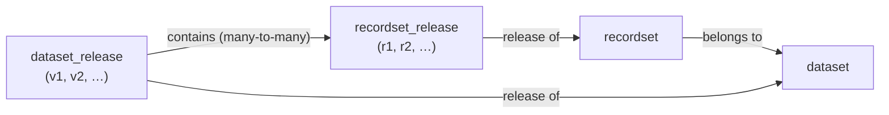

- **Ownership:** a recordset belongs to one dataset (`recordset.dataset_id`).
- **Release of:** each release points at the thing it's a release of
  (`dataset_release.dataset_id`, `recordset_release.recordset_id`).
- **Composition:** a dataset release contains specific recordset releases
  (`dataset_release_recordset`). An unchanged recordset is *carried forward*:
  the same recordset release sits in both v1 and v2.

The dataset never points at a recordset *release*, and a dataset release never
points at a *general* recordset. You get from one to the other by going around
the square.

## 3. WordPress today

Every pod is a `post_type` with `storage: meta`, REST namespace `v1`. Media is
core WP. **⇄** marks a two-way ("sister") Pods relationship: writing one side
updates the other.

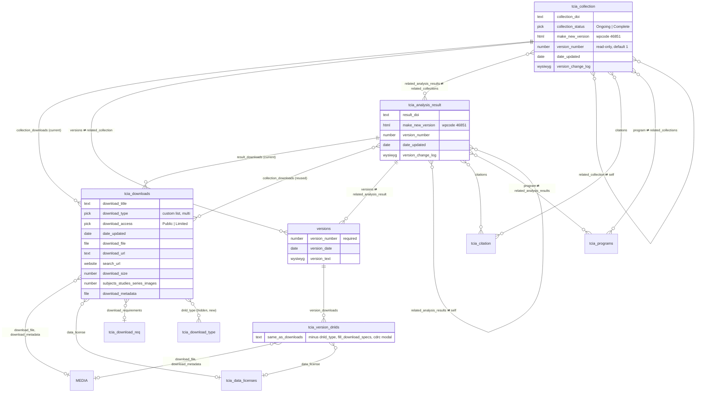

**Descriptive lookups aren't drawn above.** They are all post-type picks,
returned over REST as **names**, not IDs: `tcia_cancer_type`,
`tcia_cancer_location`, `tcia_species`, `tcia_data_type`, `tcia_file_type`,
`tcia_supporting_data`. Other extras: the `tcia_headings` taxonomy and the
`tcia_collections_settings` settings page.

### How versioning works today

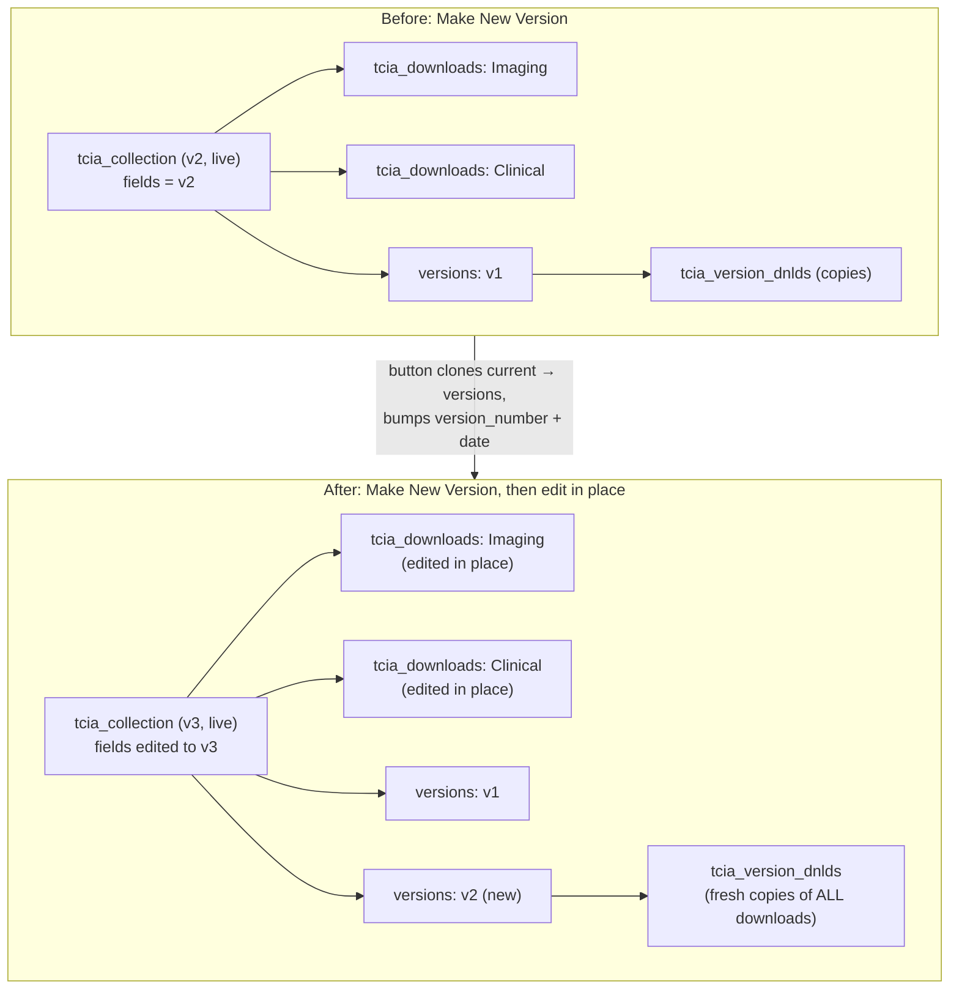

- **The collection post *is* the current version.** It holds `version_number`
  (a plain integer), `date_updated` and `version_change_log`. Its current
  downloads hang off `collection_downloads` / `result_downloads`.
- **Make New Version is a button** (WPCode snippet 46851). It clones the current
  state into a `versions` post plus copies of every download
  (`tcia_version_dnlds`), then bumps the number and date. Curators then edit the
  live post in place.
- **A previous version is a copy.** `tcia_version_dnlds` is a separate post type
  with nearly the same fields as `tcia_downloads`, so every archive duplicates
  every download under new IDs, changed or not.
- **Downloads have no back-link and no version.** The page → download pick only
  goes one way, so a download doesn't know which page it's on. One download can
  also appear on several pages: an analysis result lists other collections'
  downloads in `collection_downloads`.

### Posda ↔ WordPress mapping today

| Posda | WordPress | Linked via |
|---|---|---|
| `dataset` | `tcia_collection` / `tcia_analysis_result` | `wp_object_map` |
| `recordset` | `tcia_downloads` | `wp_object_map` |
| `file` | media attachment | `wp_object_map` (avoids uploading the same file twice) |
| `dataset_release` | — *(deferred)* | — |
| `recordset_release` | — *(deferred)* | — |

## 4. Why today's setup can't meet the needs

A WordPress post has **one** set of field values. A published post shows its
fields as they are right now, and saving changes to it is instantly public.

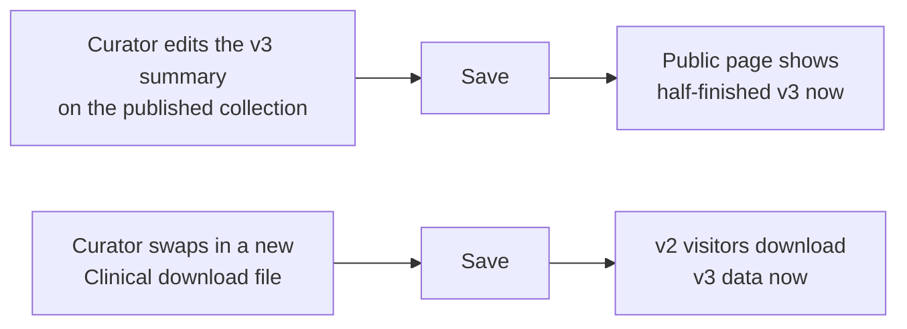

- **Need A fails** because there's nowhere to keep v3 while v2 stays live.
  "Make New Version" only archives the old state. The new state is still built
  by editing the live post.
- **Need B fails** because a download is edited in place, has no release number,
  and each dataset version gets its own full copy instead of reusing unchanged
  releases.

---

## 5. Need A — draft the next version without touching the live one

### A1 — Keep the draft in Posda (no WordPress changes)

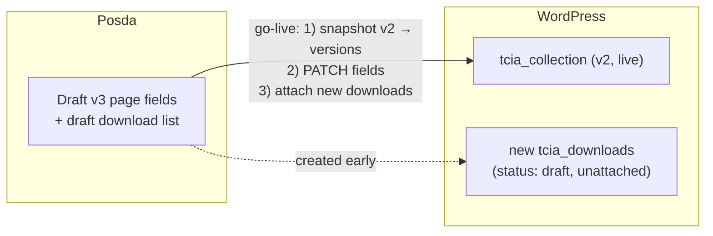

- **What changes in WordPress:** nothing.
- **How it works:** Posda holds the next version's page fields and download
  list. New download posts are created as drafts and left unattached. At
  go-live, Posda does over REST what the button does today (create the
  `versions` post and `tcia_version_dnlds` copies), then PATCHes the live
  collection and attaches the new downloads.
- **Pros:** zero WordPress work. Posda is in full control of timing.
- **Cons:** curators can't edit or preview the next version in WordPress.
  Posda would need editors for fields WordPress already has (summary, methods,
  acknowledgements…). Go-live is several separate writes, so a failure partway
  leaves a mix of old and new.

### A2 — Shadow draft post, "rewrite and republish" (small WordPress change)

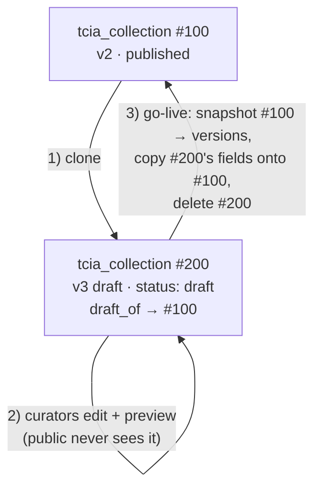

- **What changes in WordPress:** add a `draft_of` pick (collection → collection,
  and the same on `tcia_analysis_result`). Downloads that change get the same
  treatment, so also add `draft_of` on `tcia_downloads`.
- **How it works:** clone the live post into a draft copy. Curators edit and
  preview the copy like any WordPress post. At go-live the live post is
  snapshotted into `versions` (what the button does today), the copy's fields
  are written onto the live post, and the copy is deleted. The live post keeps
  its ID, slug, URL and DOI landing page. The Yoast Duplicate Post plugin
  ("Rewrite & Republish") does this if it's installed or can be. Posda could
  also do it over REST.
- **⚠ Two-way relationships.** If the clone sets `program`,
  `related_analysis_results` or `related_collection`, Pods also adds the clone
  to the *other* side's list, so a draft would show up on the Program page and
  on related collections. The clone must leave those fields empty, and go-live
  keeps the live post's values.

  ```mermaid
  flowchart LR
      CL["Draft clone #200"] -- "program = CPTAC" --> PR["tcia_programs: CPTAC"]
      PR -- "sister auto-adds #200 to<br/>related_collections" --> CL
      PR --> X["CPTAC program page now<br/>lists a draft ✗"]
  ```
- **Pros:** real drafting and preview in WordPress, the existing templates
  keep working, and the snapshot logic already exists.
- **Cons:** it's still copy-based (snapshots duplicate downloads). The
  two-way-relationship rule has to be enforced by whatever makes the clone.
  Merging the copy back is a field-by-field write.

### A3 — Versions become real pages (restructure)

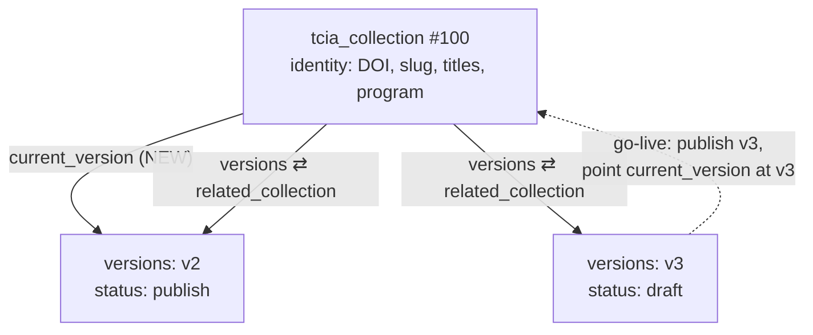

- **What changes in WordPress:**
  - `tcia_collection` / `tcia_analysis_result` keep only **identity** fields:
    DOI, slug, titles, featured image, program, related pages, and possibly
    citations.
  - Fields that change per version **move to `versions`**: downloads, version
    number, date, change log, subject count, and whichever text fields should be
    versioned (see [open question 3](#9-open-questions)).
  - New `current_version` pick on the collection → `versions` (single).
  - **The page templates change** to render from `current_version` instead of
    the collection's own fields.
- **How it works:** the next version is simply a new `versions` post in draft.
  Curators edit and preview it. Go-live publishes it and moves one pointer.
  Rolling back means moving the pointer back. Nothing is copied.
- **Pros:** drafting is native. Go-live is one atomic switch. Previous versions
  can show their full page, not just their downloads. It matches Posda's
  `dataset` / `dataset_release` exactly.
- **Cons:** templates must be rewritten (they aren't in the Pods export).
  Existing data needs migrating (the [migration sketch](#migration-sketch-a3--b3)
  is below). This is the biggest change.

---

## 6. Need B — version the downloads (recordsets)

### B1 — Posda owns recordset versions (no WordPress changes)

- **Mapping:** `recordset` → the live `tcia_downloads` post.
  `recordset_release` → the `tcia_version_dnlds` copy made when that release was
  archived.
- **How it works:** the same as today. The live download is edited in place,
  and the snapshot copies it into `tcia_version_dnlds`. Posda knows which
  release each post represents and WordPress doesn't.
- **Pros:** nothing to build in WordPress.
- **Cons:** every dataset version copies *every* download, changed or not.
  WordPress never shows a recordset's own version, and the live download is
  still edited in place (so it needs A1 or A2 to draft safely).

### B2 — Label the downloads (small WordPress change)

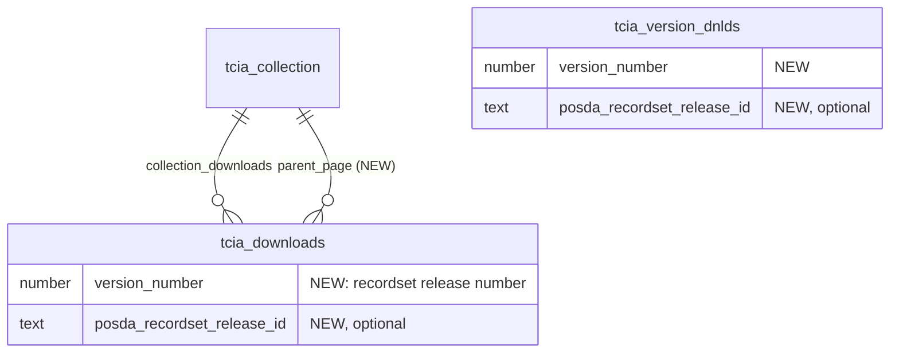

- **What changes in WordPress:** on both download pods, add a `version_number`
  (the recordset's own release number) and a `parent_page` pick (the missing
  back-link). Optionally add the Posda recordset release ID for matching.
- **How it works:** B1's behavior, but the page can show "Imaging r1 ·
  Clinical r3", and every download knows its page.
- **Pros:** small and additive, with no template rewrite needed (the label is
  optional to display).
- **Cons:** still copy-based. An unchanged recordset gets a fresh copy with
  every dataset version.

### B3 — Split downloads into identity + release (restructure)

The same split as A3, applied to downloads:

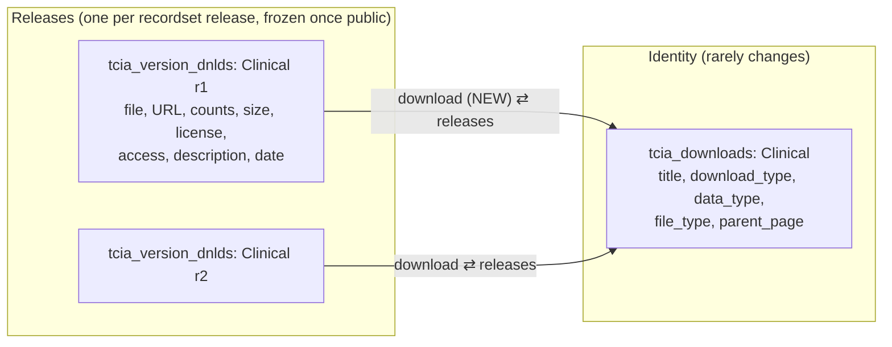

- **What changes in WordPress:**
  - `tcia_downloads` keeps only **identity**: title/slug, `download_type`,
    `data_type` / `file_type`, `parent_page` (NEW), and optionally the Posda
    recordset ID.
  - `tcia_version_dnlds` becomes **the release**: it keeps all its current
    content fields and gains a `download` pick back to its identity post plus a
    `version_number` (the recordset's own release number).
  - `versions.version_downloads` **already points at `tcia_version_dnlds`**, so
    that link doesn't change.
- **How it works:** a new recordset release is a new draft
  `tcia_version_dnlds` post. It's attached to the draft `versions` post and
  published at go-live. A recordset carried forward unchanged is just listed
  again: the same release post sits in both v1's and v2's `version_downloads`.
  A release is never edited after it's public.
- **Don't add a "current release" pointer on `tcia_downloads`.** The collection's
  current version already says which release of each recordset is live. A
  second pointer is a second source of truth that can disagree.
- **Analysis results that reuse a collection's download** should point at a
  specific `tcia_version_dnlds` (the release the analysis actually used), not
  the identity post, which would silently follow the latest release.
- **Pros:** no duplication, drafts come free, and "Clinical: r1 → r2 → r3"
  history is possible. It matches Posda's `recordset` / `recordset_release`
  exactly. It builds on the existing previous-versions data instead of
  replacing it.
- **Cons:** needs A3 to be tidy (without a `current_version` pointer, the page
  has to list release posts directly). Needs migration and template changes.

---

## 7. Putting them together

The A and B options pair naturally:

| | **A1 + B1** "Posda does it" | **A2 + B2** "minimal WordPress change" | **A3 + B3** "WordPress mirrors Posda" |
|---|---|---|---|
| WordPress schema changes | none | `draft_of` on 3 pods; `version_number` + `parent_page` on 2 download pods | collection/download pods slimmed to identity; `current_version`, `download`, `version_number` added |
| Template changes | none | none | collection, analysis-result and download templates |
| Data migration | none | none (new fields start empty) | yes (sketch below) |
| Draft editing & preview in WordPress | ✗ (Posda UI) | ✓ | ✓ (native) |
| Go-live | several writes by Posda | merge draft copy into the live post | publish + move one pointer |
| Rollback | manual | manual | move the pointer back |
| Unchanged downloads copied per version | yes | yes | no, reused |
| Recordset version visible on the site | no | yes (label) | yes (real history) |
| Two-way-relationship risk | low | **must be managed** | low |
| Fit with Posda's model | loose | close | exact |

**Recommendation:**
- **A2 + B2** if the goal is the smallest change that meets both needs. It gives
  real drafts in WordPress, keeps every template, and needs no data migration.
- **A3 + B3** is the correct end state. WordPress and Posda would have the same
  structure, there are no copies to keep in sync, and go-live and rollback are a
  single switch.
- A2 + B2 → A3 + B3 is a reasonable path too. B2's `parent_page` and
  `version_number` fields carry straight over into B3.

> **2026-10-06:** A3's pointer was considered and rejected. The versions would
> have to be public, search/indexing/caching need the fields stored on the
> master post, and Jeff's code would need a rewrite. The team went with **A4**
> instead; see [section 11](#11-2026-10-06-meeting-direction).

### How Posda maps under each

| Posda | A1 + B1 | A2 + B2 | A3 + B3 |
|---|---|---|---|
| `dataset` | `tcia_collection` | `tcia_collection` | `tcia_collection` (identity) |
| `dataset_release` | `versions` (on archive) | `versions` (on archive) | `versions` (**draft → current**) |
| `recordset` | `tcia_downloads` | `tcia_downloads` | `tcia_downloads` (identity) |
| `recordset_release` | `tcia_version_dnlds` (on archive) | `tcia_version_dnlds` (on archive) | `tcia_version_dnlds` (**the release**) |

### Go-live under A3 + B3

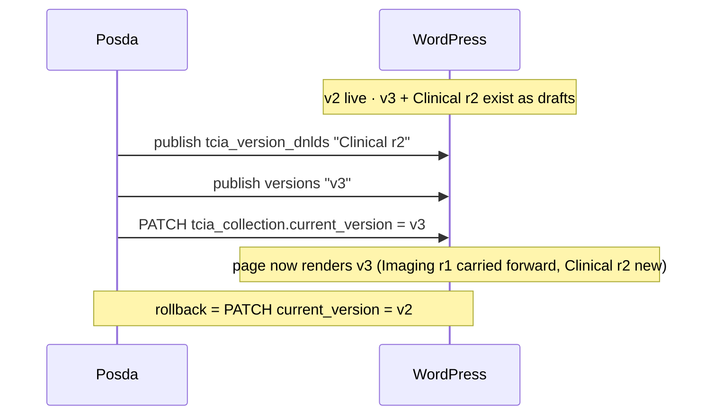

### Migration sketch (A3 + B3)

1. **Collections:** for each collection / analysis result, create a
   `versions` post from its current fields (version number, date, change log,
   downloads, and any other fields that move) and set `current_version` to it.
2. **Downloads:** for each `tcia_downloads` post, create a
   `tcia_version_dnlds` release holding its current content, point the release's
   `download` back at it, then strip it down to identity fields. Put the new
   release in the new current `versions` post from step 1.
3. **Existing previous versions:** their `version_downloads` already point at
   `tcia_version_dnlds`, so they keep working. They were copies with no
   back-link, so linking them to an identity post means matching by title and
   collection. Leaving old ones unlinked is an acceptable fallback, since the
   link can be optional.
4. **Analysis results:** repoint `collection_downloads` at the specific
   `tcia_version_dnlds` releases they used.
5. **Templates:** switch collection, analysis-result and download rendering to
   read through `current_version`.

---

## 8. Worked example (A3 + B3)

TCGA-XYZ has two recordsets, Imaging and Clinical. v2 changes only Clinical.

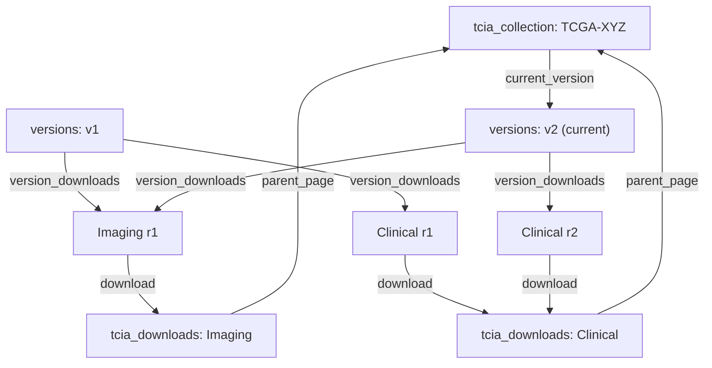

| Post | Links to |
|---|---|
| `tcia_downloads` "Imaging" | `parent_page` → TCGA-XYZ |
| `tcia_downloads` "Clinical" | `parent_page` → TCGA-XYZ |
| `tcia_version_dnlds` "Imaging r1" | `download` → Imaging |
| `tcia_version_dnlds` "Clinical r1" | `download` → Clinical |
| `tcia_version_dnlds` "Clinical r2" | `download` → Clinical |
| `versions` "v1" | `version_downloads` → Imaging r1, Clinical r1 |
| `versions` "v2" | `version_downloads` → Imaging r1, **Clinical r2** |

**Which link answers which question:**
- *What does the public page show?* collection → `current_version` →
  `version_downloads`. This is the only path the page needs.
- *What recordsets does this collection have?* `tcia_downloads` whose
  `parent_page` is the collection.
- *What's the history of Clinical?* releases whose `download` is Clinical:
  r1, r2.

The collection → general recordset link only says "these belong to me". Which
release is live always goes through the version.

---

## 9. Open questions

1. ~~**Are Yoast Duplicate Post or PublishPress Revisions installed, or
   allowed?**~~ *Moot (2026-10-06): A4 clones into its own pod, and Jeff's hook
   does the publish.*
2. **Do the templates show a download that's attached but still in draft
   status?** The download picks accept any status. If drafts are hidden,
   attaching new downloads early is safe, which helps A1 and A2.
3. ~~**Which collection fields are per-version?**~~ *Answered (2026-10-06):
   all of them. The version pods are full clones ("holistic" versioning).*
4. **Who can change the Pods templates** (Collection Template A, Analysis
   Result Template A, list templates)? Jeff. Under A4 they don't change for the
   live page; a previous-version view is new work.
5. ~~**DOIs:** does a version ever get its own DOI?~~ *Answered (2026-10-06):
   yes, Justin wants a DOI per dataset version; the parent DOI always resolves
   to the newest. Not for recordset releases. How a version DOI resolves is
   open; see [11.3](#113-open).*

Questions raised on 2026-10-06 are in [11.3](#113-open).

## 10. Side notes on `oneposda` `wp.py`

- **`dcid_type` — to explore.** `format_download` reads it and has done so since
  `wp.py` was created (commit `59e06257`, 2026-05-21). No pod defines it, none
  of 100 live download records has the key, and nothing reads it. The nearest
  real field is `dnld_type` (the hidden "Download Type (new)" pick →
  `tcia_download_type`), which is `false` on all 100 sampled records. Probably
  a typo or leftover of `dnld_type`.
- `versions.related_collection` / `related_analysis_result` come back as a
  **name**, not an ID. Resolve a version's parent through the parent's
  `versions` list instead.
- Known and fine: download `cancer_type` / `cancer_location` / `species` are
  not readable over REST (always null). Version downloads lack
  `fill_download_specs` and `display_cdrc_modal_dialog`, so those keys come back
  empty.

---

## 11. 2026-10-06 meeting: direction

Attendees: Michael, Jeff (WordPress), Tracy (curation, left early).

### 11.1 Decision: A4, "version pods + publish to master"

Jeff's model. It sits between A2 and A3: the drafts live in their own pod (like
A3's versions), but the live page is still a full copy on the collection post
(like A2), so nothing that reads the live page changes.

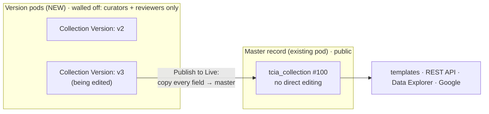

- **New pods:** "Collection Versions" and "Analysis Result Versions", made by
  **cloning** the existing pods, so they have every field (Jeff has a lot of
  JavaScript tied to the pod settings; cloning beats rebuilding them on
  `versions`).
- **Holistic versioning:** every field is versioned, DOI and short title
  included, so a diff between versions can cover anything. No deciding which
  fields count.
- **Master record** = the existing `tcia_collection` / `tcia_analysis_result`
  post. Templates, API, Data Explorer and search keep reading it unchanged.
  Nobody edits it directly; it is only written by Publish to Live.
- **Editing a version:** curators edit a version record in a form that looks
  like today's. Reviewers (e.g. Ramesh) get a non-public preview. Comments can
  live on the version record and are never copied to the master.
- **Republish without re-versioning:** a version can be tweaked and published
  again as often as needed ("stone tablet"). A new version number only happens
  when someone explicitly makes a new version. This answers Tracy's concern
  about finalize churn producing dozens of versions.
- **Rollback** = publish an older version record.
- **Not WordPress "draft" status.** Version records are published posts in a
  walled-off post type. Jeff can lock down a whole post type, but not single
  records inside the live pod.
- **Downloads:** a new version links the *same* download records as the one it
  was made from. A changed download is duplicated and the copy is changed; a
  removed one is unlinked. Unchanged downloads are never copied.
- **Publish runs inside WordPress.** Jeff writes a PHP hook that does the whole
  publish; Posda's button calls it. That keeps it one transaction that can be
  rolled back, instead of several REST writes from Posda.
- **Everything stays in WordPress** (A1 is out): not all data goes through
  Posda.

Rejected: **A3's pointer** (see the note under section 7).

### 11.2 Agreed in passing

- Recordset **version numbers are on hold** for WordPress. Posda tracks
  recordset releases itself, as long as each one links to the right download
  record. Jeff can add a WordPress field later if needed.
- Previous versions stay downloadable by the public: researchers cite a version
  (e.g. "CMB-MML v6") and need its files. Jeff's idea: a version picker on the
  live page that renders the chosen version on a temporary page.
- Merging the collection and analysis-result structures was raised and dropped.
- Fill Download Specs from NBIA will be replaced by Posda pushing the counts.

### 11.3 Open

1. **Version DOIs vs walled-off versions.** A version DOI needs a stable public
   URL (e.g. `…/collection-slug/v1`), but a version rendered on request isn't
   one. Jeff's alternative: make the version pods public, and add a separate
   private **staging** pod for drafts. Then Publish to Live writes both the
   master record and a public version record. Jeff to test how locked down a
   walled-off post type really is.
2. **The existing `versions` pod.** A4 makes it redundant.
   - Michael: copy (ETL) its records into the new version pods.
   - Jeff: leave old versions where they are for pre-A4 history.
   - Against Jeff's option: previous versions would live in two places.
   - Against the ETL: old versions' text is unknown, so they'd be backfilled
     with today's values. They should be marked "pre-versioning" so a diff
     doesn't show false history.
3. **Where download releases live under A4 — for the next discussion.**
   It came up twice but wasn't settled:
   - Jeff (~11:11): his version records "would replace version downloads". A
     version record links its downloads directly, and `versions` +
     `tcia_version_dnlds` retire together.
   - Michael (~11:22): handle recordsets like datasets, with even the current
     release in version downloads (B3). Jeff was wary of extra records, and
     recordset versioning was put on hold.

   Options:
   - **(i) Version records link `tcia_downloads` directly.** Each download post
     becomes a frozen recordset release (a change means duplicating it). One
     download pod, but a new release sits in the public pod before go-live
     (Jeff can't wall off single records in a live pod), and WordPress has no
     recordset-level post, so `wp_object_map` must map
     `recordset_release → tcia_downloads`.
   - **(ii) A4's pattern one level down.** A walled-off pod holds download
     releases; Publish to Live copies the release onto the `tcia_downloads`
     post, which stays the public recordset. Hides unreleased downloads,
     keeps `recordset → tcia_downloads`, and adds the missing release →
     download back-link. Costs: the publish hook also writes download fields,
     and the previous-version view reads the walled-off pod (ties to item 1).
     Jeff wasn't keen on repurposing `versions`, so the release pod would
     likely be a **new clone of `tcia_downloads`** rather than a repurposed
     `tcia_version_dnlds`.

   Either way `tcia_version_dnlds`' existing records (per-version copies,
   labeled with the dataset version, no back-link) are legacy, like the old
   `versions` records in item 2.
4. **Two-way relationships on the cloned pods.** If the version pods'
   `program` / related-collection picks are set up as sister (two-way) fields,
   draft versions will appear on Program and related-collection pages (the A2
   problem). The cloned pods' picks should be one-way.
5. **Scope this quarter.** Probably planning and testing only, implementation
   next quarter. Michael's actual blocker is that Make New Version
   (WPCode 46851) copies unchanged downloads, which breaks Posda's one-to-many
   link at the dissemination step. **Stopgap:** Jeff changes 46851 to stop
   copying unchanged downloads. If that lands, implementing A4 can wait.

### 11.4 Next steps

1. Jeff: have Scott clone production to the **staging** server.
2. Jeff: upgrade Pods on staging, then production, **before** any versioning
   work. Pods is well behind (held back by the inline-PHP issue).
3. Jeff: prototype the cloned version pod and the lockdown on staging.
4. Michael: point Posda at staging to test linking.
5. Reconvene: maybe next week; plan on ~2026-10-20.

---

## 12. Proposal: two options for version pods

**First proposed 2026-10-07; revised 2026-11-20 after a follow-up meeting.
Still undecided between two options.** Examples use collections; analysis
results get the same design ([12.3](#123-shared-analysis-results)). Pod and
field names are placeholders.

- **Option 1 — copy to the live post.** Versions live in walled-off pods.
  Publish copies them onto `tcia_collection`. Templates and API unchanged.
- **Option 2 — the live post points at a version.** All fields live only on
  the version. `tcia_collection` keeps identity and a `current_version`
  pointer. Templates, API and search change.

Concerns raised at the follow-up meeting, which both options must meet:
working versions walled off from the public while being edited; a submitter
can review and approve before go-live; nothing crawled or indexed before
release.

### 12.1 At a glance

Option 1: publish copies the version onto the live post.

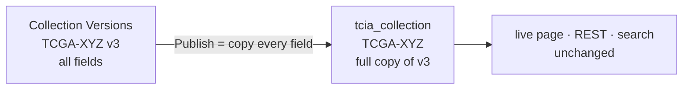

Option 2: the live post points at the version.

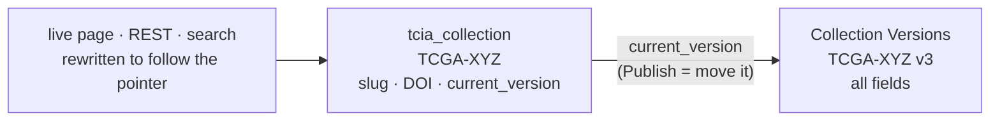

| | Option 1 · copy | Option 2 · pointer |
|---|---|---|
| Where fields live | on the version and copied to the live post | on the version only |
| Templates | no change (optional "v2" labels) | Collection / Analysis Result Template A and list templates read through `current_version` |
| REST API, Data Explorer, `wp.py` | no change | follow the pointer, or a compatibility endpoint returns the live version flattened |
| Site search, caching | no change | index only released versions; clear cache when the pointer moves |
| Working versions hidden by | the whole version pod is walled off | per-post status (draft / pending) plus `noindex` |
| Publish | copy every field (one PHP transaction) | move one pointer, set v3 to published |
| Rollback | republish the older version (copy again) | move the pointer back |
| Old versions on the public site | a version picker renders them from the walled-off pod | every released version is a real public page |
| Version DOI landing page | needs a third, public pod later | built in: the released version's own page |
| Data stored twice | yes: every field, version + live post | no |
| Migration | make one version post from each live post | move every field off each live post into a version post |
| Jeff's work | 3 cloned pods, 3 hooks, lockdown, picker | Option 1's pods and hooks, plus templates, REST, search, migration |
| Main risk | the copy and the version drift apart | size of the change; every consumer of the API is touched |

### 12.2 Shared: the version pods

| Pod | Holds | Status |
|---|---|---|
| **Collection Versions** | one post per collection version (TCGA-XYZ v1, v2, v3) | NEW, cloned from `tcia_collection` |
| **Analysis Result Versions** | one post per analysis result version | NEW, cloned from `tcia_analysis_result` |
| **Download Versions** | one post per download version (Clinical v1, v2) | NEW, cloned from `tcia_downloads` |
| `versions`, `tcia_version_dnlds` | today's copies | retire ([12.9](#129-existing-data)) |

New fields on the version pods:

| Field | Type | Purpose |
|---|---|---|
| `live_post` | pick, one-way | the `tcia_collection` / `tcia_downloads` post it belongs to |
| `version_number`, `version_date`, `version_change_log` | number, date, wysiwyg | version bookkeeping |
| `state` | pick | `working` → `in review` → `approved` → `live` → `superseded` |
| `submitter_approval` | text + date | who approved, when ([12.5](#125-shared-submitter-review)) |
| `reviewer_notes` | wysiwyg | internal; never public |

Rules:
1. `collection_downloads` on a Collection Versions post lists **Download
   Versions** posts.
2. Every pick on a version pod is **one-way** (no sister fields), so working
   versions never appear on Program or related pages.
3. An unchanged download is **listed again, never copied**.
4. A download version that an older collection version lists is **frozen**. A
   fix means the next download version.

Worked example:

| Collection Versions post | Imaging | Clinical | Pathology |
|---|---|---|---|
| TCGA-XYZ v1 | v1 | v1 | — |
| TCGA-XYZ v2 | v1 | **v2** | — |
| TCGA-XYZ v3 (live) | v1 | v2 | **v1** |

Bold = a new Download Versions post. Four Download Versions posts in total;
Imaging v1 is listed three times and stored once.

Lifecycle:

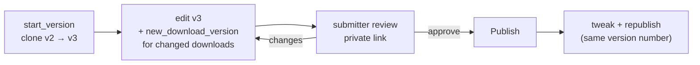

### 12.3 Shared: analysis results

| Collections | Analysis results |
|---|---|
| `tcia_collection` | `tcia_analysis_result` |
| Collection Versions | Analysis Result Versions |
| `collection_downloads` | `result_downloads` |
| `collection_doi` | `result_doi` |
| Collection Template A | Analysis Result Template A |

- Both share the one Download Versions pod.
- **The one difference:** an analysis result's reused `collection_downloads`
  (other collections' downloads) point at the Download Versions posts the
  analysis used, so they stay frozen. What the live page shows is
  [12.10 question 6](#1210-questions-for-jeff).

### 12.4 Shared: keeping working versions private

| Leak path | Protection |
|---|---|
| Direct URL to the post | Option 1: pod not publicly viewable · Option 2: post status draft / pending. Either way: login or a preview token only |
| Google and other crawlers | `noindex, nofollow` meta tag and `X-Robots-Tag` header on every preview; never linked from a public page |
| XML sitemaps | version pods excluded (or only released versions, Option 2) |
| REST API (`/wp-json/…`) | working versions need authentication; public REST returns only live / released |
| Site search, Data Explorer | read only live posts (Option 1) or released versions (Option 2) |
| Program and related pages | one-way picks on version pods (rule 2) |
| **Download files** | a file in `/wp-content/uploads` is public to anyone with the URL. Unreleased files stay out of the public uploads folder (or behind access control) until Publish |

`robots.txt` alone isn't enough: it asks crawlers not to fetch, but a linked
URL can still be indexed. Use `noindex` plus access control.

### 12.5 Shared: submitter review

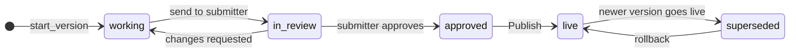

| How the submitter sees it | Needs a WP account | Notes |
|---|---|---|
| **Secret preview link** (token, expires) | no | easiest for submitters; page sends `noindex`; link can be revoked |
| Reviewer account (read-only role) | yes | strongest control; an account per submitter |
| Password-protected post (WP core) | no | shared password; Option 2 only (Option 1's pod is walled off anyway) |

- Approval records `submitter_approval` (who, when).
- Publish requires `state = approved`.

### 12.6 Option 1: copy to the live post

Least disruption. Live posts and everything that reads them stay as they are.

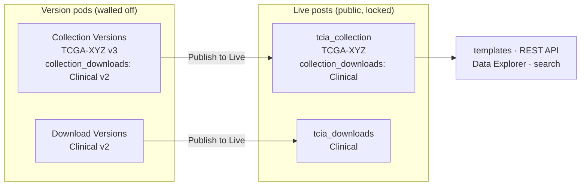

Publish (one PHP transaction):
1. Each Download Versions post v3 lists that's still working: create its
   `tcia_downloads` post if missing, copy fields onto it.
2. Copy v3's fields onto `tcia_collection`.
3. Set `tcia_collection.collection_downloads` to those `tcia_downloads` posts.
4. v3 → `live`, v2 → `superseded`.

| Fields | On publish |
|---|---|
| everything versioned (title, summary, methods, citations, counts, file, size, …) | copied |
| `version_number`, `version_date`, `version_change_log` | copied |
| post ID, slug, `collection_doi` | never overwritten |
| `state`, `reviewer_notes`, `submitter_approval`, `live_post` | never copied |

Changes to live pods:
- `tcia_collection`, `tcia_analysis_result`, `tcia_downloads`: locked in
  admin; only Publish writes.
- `tcia_downloads` gains `version_number` ("Clinical v2").
- A brand-new download or collection gets its live post at its first Publish.

| Pros | Cons |
|---|---|
| templates, REST, Data Explorer, search untouched | every field stored twice |
| smallest build; can start next quarter | old versions and version DOIs need extra work (picker, third pod) |
| whole pod walled off: simple privacy | rollback re-copies |

### 12.7 Option 2: the live post points at a version

The "correct" model: one copy of every field, on the version. It's A3 + B3
([sections 5](#5-need-a--draft-the-next-version-without-touching-the-live-one)
and [6](#6-need-b--version-the-downloads-recordsets)), built on the version
pods above.

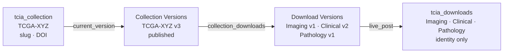

| Post | Keeps |
|---|---|
| `tcia_collection` | post ID, slug, `collection_doi`, `current_version` (NEW pick) |
| Collection Versions | every other collection field |
| `tcia_downloads` | identity: title, `download_type`, `data_type`, `file_type` |
| Download Versions | file, URL, counts, size, license, access, description, date |

Publish:
1. v3 and its working Download Versions posts → WP status **publish**,
   `state = live` / `released`.
2. `tcia_collection.current_version` = v3.
3. v2 → `superseded` (stays public as the v2 page).
4. Clear the page cache for TCGA-XYZ.

Rollback = set `current_version` back to v2.

| Area | Change |
|---|---|
| Templates | Collection Template A, Analysis Result Template A, list templates read `current_version`'s fields |
| REST API | consumers follow the pointer, or a compatibility endpoint returns the live version flattened (keeps Data Explorer and `wp.py` working) |
| Search | index released Collection Versions posts, mapped back to the collection URL |
| Caching | flush the collection page when `current_version` moves |
| Version URLs | each released version gets a public page, e.g. `…/tcga-xyz/v2`: the version DOI landing page |
| Migration | move every field off each live post into a version post ([12.9](#129-existing-data)) |

| Pros | Cons |
|---|---|
| one source of truth, nothing copied | templates, REST, search, cache all change |
| publish and rollback are one switch | privacy is per post (status), not per pod |
| old versions and version DOIs come free | bigger migration; the reasons A3 was turned down on 2026-10-06 still apply |
| matches Posda's model exactly | |

### 12.8 Path and phasing

**Option 1 can become Option 2 later.** The version pods, fields, hooks and
review flow are the same. Moving to Option 2 means: stop copying, add
`current_version`, switch templates and REST. No version data is redone.

| When | What |
|---|---|
| Now | Stopgap: Make New Version (WPCode 46851) stops copying unchanged downloads |
| Now | Staging clone, Pods upgrade, privacy test ([12.4](#124-shared-keeping-working-versions-private)) |
| Next quarter | Version pods, hooks, submitter review; publish as Option 1 |
| Later (if chosen) | Switch to Option 2: pointer, templates, REST, search |

Hooks (both options; PHP, one transaction each, callable from an admin button
and an authenticated REST route):

| Hook | Does |
|---|---|
| `start_version(live_post)` | clone the live version, `state = working`, number + 1 |
| `new_download_version(collection_version, from?)` | clone a Download Versions post (or start v1) and swap it in |
| `publish(collection_version)` | Option 1: copy · Option 2: move pointer |

### 12.9 Existing data

| Data | Option 1 | Option 2 |
|---|---|---|
| each `tcia_collection` | make a Collection Versions post from its fields (`state = live`) | same, then strip the live post to identity and set `current_version` |
| each `tcia_downloads` | make Download Versions v1 from its fields | same, then strip it to identity |
| old `versions` + `tcia_version_dnlds` | undecided ([11.3 item 2](#113-open)): copy in as `superseded`, marked "pre-versioning" (download numbers worked out by comparing copies), or leave in place and have the picker read both | same |

### 12.10 Questions for Jeff

1. **Privacy:** can a working version be hidden on every path in
   [12.4](#124-shared-keeping-working-versions-private)? (pod lockdown for
   Option 1, post status for Option 2)
2. **Download files:** where do unreleased files go so their URLs aren't
   public?
3. **Submitter review:** preview link or reviewer account?
4. **Option 2 size:** which templates and REST consumers read collection
   fields directly?
5. **Option 2 search/cache:** can they work from the current version post?
6. Analysis results: should reused `collection_downloads` follow the other
   collection's latest download, or the version the analysis used?
7. Rule 4 (frozen download versions): enforced in Pods, or in the hooks?
8. Custom REST routes for the hooks: OK?

### 12.11 Appendix: Posda and alternatives

How Posda calls the hooks (either option):

| Curator in Posda… | Posda calls | Posda stores |
|---|---|---|
| starts the next release | `start_version` | Collection Versions post ID |
| releases a new / changed download | `new_download_version`, then uploads files and counts | Download Versions post ID |
| disseminates | `publish` | IDs of any new `tcia_downloads` posts |

In `wp_object_map` terms: `dataset_release` → Collection / Analysis Result
Versions post and `recordset_release` → Download Versions post are new;
`dataset` and `recordset` map to the live posts as today.

Download alternatives considered:

| | Download Versions pod | Freeze `tcia_downloads` | Repurpose `tcia_version_dnlds` |
|---|---|---|---|
| One post per download | ✓ | ✗ | ✓ |
| Unreleased downloads hidden | ✓ | ✗ | only if walled off |
| Same pattern as collections | ✓ | ✗ | partly |
| Repurposes an existing pod | no | no | yes (Jeff wasn't keen on that for `versions`) |

---

## 13. Final solution (draft): version pods, version pages, preview

Standalone; details to finalize are in [13.10](#1310-to-finalize). Built on
Option 1 ([12.6](#126-option-1-copy-to-the-live-post)): least disruption to
templates and API, with previous-version pages and submitter preview added.
Examples use collections; analysis results are the same with the swaps in
[13.9](#139-analysis-results).

### 13.1 Anchors and versions

Each anchor pod gets one version pod, cloned from it:

| Anchor pod (public, locked) | Version pod (walled off, NEW) | Label | One anchor per… |
|---|---|---|---|
| `tcia_collection` | `collection_ver` | Collection Versions | collection |
| `tcia_analysis_result` | `analysis_result_ver` | Analysis Result Versions | analysis result |
| `tcia_downloads` | `download_ver` | Download Versions | download (shared by collections and analysis results) |

Post type names are capped at 20 characters by WordPress.

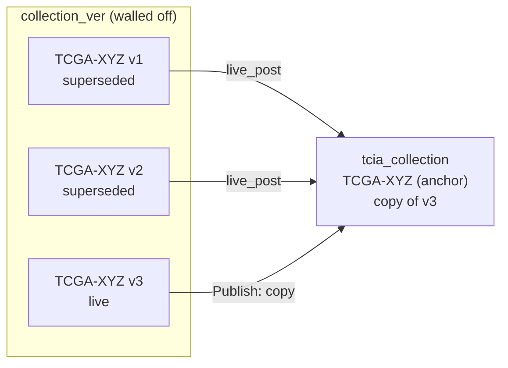

The same shape for analysis results (`analysis_result_ver` → `tcia_analysis_result`)
and downloads (`download_ver` → `tcia_downloads`).

| Post | How many | Public | Holds |
|---|---|---|---|
| `tcia_collection` / `tcia_analysis_result` (anchor) | **one per collection / analysis result, forever** | yes, locked | a copy of the live version; same ID, slug, DOI |
| `collection_ver` / `analysis_result_ver` | one per version | no | every field of that version |
| `tcia_downloads` (anchor) | **one per download, forever** | yes, locked | a copy of the live download version |
| `download_ver` | one per download version | no | every field of that download version |

- Only Publish writes to an anchor.
- A brand-new collection, analysis result or download gets its anchor at its
  first Publish.
- Templates, REST and Data Explorer keep reading anchors, unchanged.

### 13.2 Fields added to the version pods (on top of the cloned anchor fields)

Each version pod starts as a clone of its anchor pod, so it has every anchor
field. Added:

| Field | Purpose | `collection_ver` / `analysis_result_ver` | `download_ver` |
|---|---|---|---|
| `version_number` | version | already on the anchor | **new** |
| `date_updated` | version date | already on the anchor | already on the anchor |
| `version_change_log` | what changed | already on the anchor | **new** |
| `live_post` | the anchor (one-way pick) | **new** | **new** |
| `state` | `working`, `in review`, `approved`, `live`, `superseded` | **new** | **new** |
| `approved_by`, `approved_date` | who approved, and when | **new** | **new** |
| `preview_token`, `preview_expires` | the submitter's preview link | **new** | **new** |
| `reviewer_notes` | internal, never public | **new** | **new** |

`version_number` is also added to `tcia_downloads` ("Clinical v2").

**Keeping the pods in step:** a field added to an anchor pod is added to its
version pod too.

### 13.3 Rules

1. A `collection_ver` post's `collection_downloads` lists **`download_ver`**
   posts.
2. Every pick on a version pod is **one-way**, so working versions never show
   up on Program or related pages.
3. An unchanged download is **listed again, never copied**.
4. A download version that an older collection version lists is **frozen**. A
   fix means a new download version.

### 13.4 Three views, one renderer

The version page and preview reuse the existing templates. A **route** (PHP)
loads the version post, checks who may see it, and fills the template from it.
Only who can see the page differs.

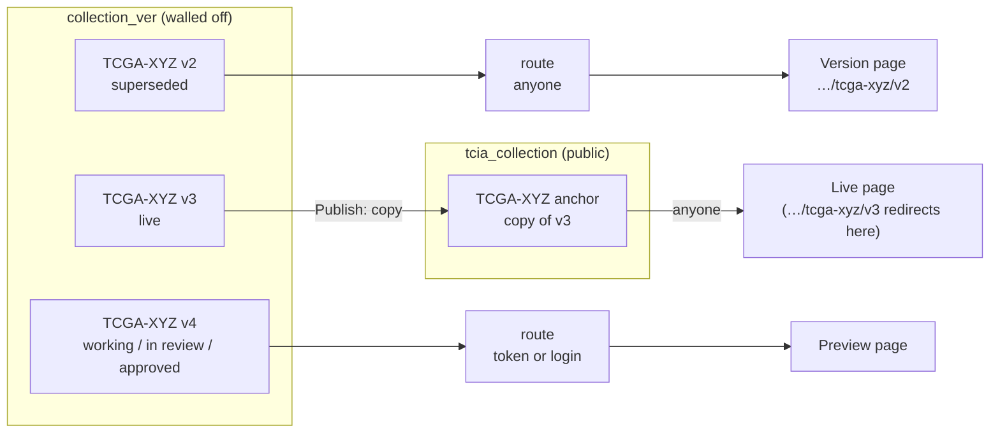

| View | Pod | Post state | Who | Search engines |
|---|---|---|---|---|
| Live page | `tcia_collection` | the anchor | everyone | indexed; current version first |
| Version page `…/tcga-xyz/v2` | `collection_ver` | `superseded` | everyone | TBD; canonical → live page |
| Preview page | `collection_ver` | `working` / `in review` / `approved` | submitter (token), curators (login) | `noindex`, not cached, not linked |

For analysis results, swap in `tcia_analysis_result` / `analysis_result_ver`.
Downloads on each page come from `download_ver` (version page, preview) or
`tcia_downloads` (live page).

- **Version page:** starts with that version's downloads (today's display).
  Grows into the full page and "what changed" without new architecture. Its
  URL is stable, so a version DOI can point at it.
- **Preview:** exactly what goes public after Publish, with downloads.
- **One check:** the route is the only way into a version post. For
  `…/tcga-xyz/vN`:

  | When vN is | Route does |
  |---|---|
  | `live` | redirect to the live page (the anchor) |
  | `superseded` | version page |
  | `working` / `in review` / `approved` | preview with token or login; otherwise "not found" |

### 13.5 Flow

```mermaid
stateDiagram-v2
    direction LR
    [*] --> working: start_version
    working --> in_review: send_preview
    in_review --> working: changes needed
    in_review --> approved: record_approval
    approved --> live: publish
    live --> superseded: next version goes live
    superseded --> live: rollback
```

| Hook | Does | Caller |
|---|---|---|
| `start_version` | clone the live version, number + 1 | WP button or Posda |
| `new_download_version` | clone a download version (or start v1), swap it in | WP button or Posda |
| `send_preview` | make a token link, `state = in review` | curator |
| `record_approval` | `state = approved`, sets `approved_by`, `approved_date` | TBD (see 13.10) |
| `publish` | requires `approved`; see 13.6 | WP button or Posda |

### 13.6 Publish (one PHP transaction)

0. **Drift guard:** if an anchor pod has a field its version pod lacks, stop
   and name the field. Nothing is written.
1. Each new download version: create its `tcia_downloads` anchor if missing,
   copy fields, make its files public.
2. Copy the version's fields onto `tcia_collection`; set its
   `collection_downloads` to the download anchors.
3. New version → `live`; previous → `superseded` (its version page goes
   public).
4. Expire the preview token.

Never copied: `state`, `approved_*`, `preview_*`, `reviewer_notes`,
`live_post`. Never overwritten: anchor ID, slug, `collection_doi`.

### 13.7 Privacy and files

| Path | Rule |
|---|---|
| Version posts | no public URL, archive, search, sitemap or public REST; the route is the only way in, and it checks state |
| Search, sitemap | version pods excluded |
| REST | released versions: public, read-only · earlier states: authenticated |
| Preview page | `noindex`, `X-Robots-Tag`, no page cache |
| Files, unreleased | private storage, downloadable only with token or login |
| Files, released | public; moved at Publish |
| Link-out downloads (NBIA, Aspera, IDC) | the link shows only in preview until Publish; the external system must also hold the data until release |

### 13.8 Old and new side by side

| Collection | Versions handled by |
|---|---|
| New collection | new method only |
| Existing, next update | new method from then on: `start_version` makes the first `collection_ver` post from the anchor |
| Existing, not yet updated | old method, unchanged |
| Versions made before the switch | stay in `versions` / `tcia_version_dnlds`; shown as today |

- The previous-versions list reads both sources: old versions from `versions`,
  new ones from `collection_ver`.
- Make New Version (WPCode 46851) is turned off per collection once it has
  switched.
- `versions` and `tcia_version_dnlds` retire when no live collection needs
  them; migrating them is optional and later.

### 13.9 Analysis results

| Collections | Analysis results | Desc |
|---|---|---|
| `tcia_collection` | `tcia_analysis_result` | anchor pod (public, locked) |
| `collection_ver` | `analysis_result_ver` | version pod (walled off) |
| `collection_downloads` | `result_downloads` | the page's own downloads |
| `collection_doi` | `result_doi` | canonical DOI, kept on the anchor |

Shared `download_ver` pod. Analysis results have two downloads picks:

| Field | Lists | On `analysis_result_ver` it points at |
|---|---|---|
| `result_downloads` | the analysis result's own downloads | its own `download_ver` posts |
| `collection_downloads` | other collections' downloads it reused | the `download_ver` posts of the versions it used (frozen by rule 4) |

### 13.10 To finalize

| # | Detail | Question | Options |
|---|---|---|---|
| 1 | Version page indexing | Should Google list old version pages (`…/tcga-xyz/v2`)? | **A.** Index, canonical → live page: findable, but Google treats the live page as the main one. **B.** `noindex` + canonical → live page: never in search; reached from the live page or a DOI. **C.** Index on its own: v2 could outrank the current version (rules out "current first"). |
| 2 | Version page content | What does a version page show? | **A.** Downloads only (today's display) at first. **B.** The full page as it was, plus what changed from the previous version. A can grow into B without changing the architecture. |
| 3 | Private file storage | Where does an unreleased download's file live, so it can't be fetched by URL before release, but the preview can still serve it? | **A.** Outside public media; the Publish hook uploads it to public media at release. **B.** One storage place, with files served through a download endpoint that checks the token or login until release. |
| 4 | Preview token | How does the submitter's preview link behave? | How long it lasts; whether it can be revoked or reissued; one link per version or one per submitter. |
| 5 | Who records approval | Who calls `record_approval`? | **A.** A curator, after the submitter says OK by email. **B.** The submitter, with an Approve button on the preview page (the token identifies them). |
| 6 | Walled-off pods | Can the version pods really be hidden on every path in 13.7? | Test on staging: direct URL, archive, search, sitemap, REST, feeds. |
| 7 | Rule 4 (frozen download versions) | Where is it enforced that a download version used by an older collection version can't be edited? | **A.** In Pods (field or admin restrictions). **B.** In the hooks and admin screens (block the save, offer "make a new version"). |
| 8 | Field drift | How do the anchor and version pods keep the same fields? | Drift guard in Publish (stops and names a missing field) + a checklist step whenever a field is added to an anchor pod. |
| 9 | `version_change_log` on `tcia_downloads` | Should the live page show what changed in each download? | **A.** Yes: add the field to the anchor, and Publish copies it. **B.** No: the change log shows only on version pages. |
| 10 | Reused downloads on a live analysis result | When another collection releases a new download version, what does the analysis result's live page show? | **A.** Follow the latest: list the other collection's download anchor (today's behavior). **B.** The version used: list what the analysis actually used, even if it's older. |
| 11 | Migrating old `versions` | Do pre-switch versions (`versions` / `tcia_version_dnlds`) move into the new pods? | **A.** Never: show them from the old pods for good. **B.** Later, when convenient: copy them in, marked "pre-versioning". **C.** Before the old pods retire. |
